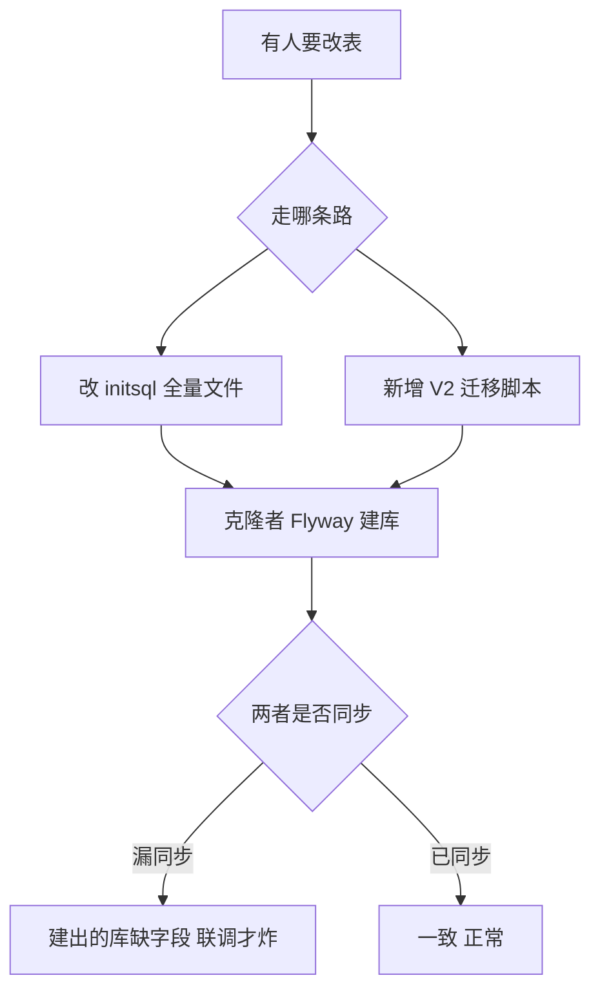
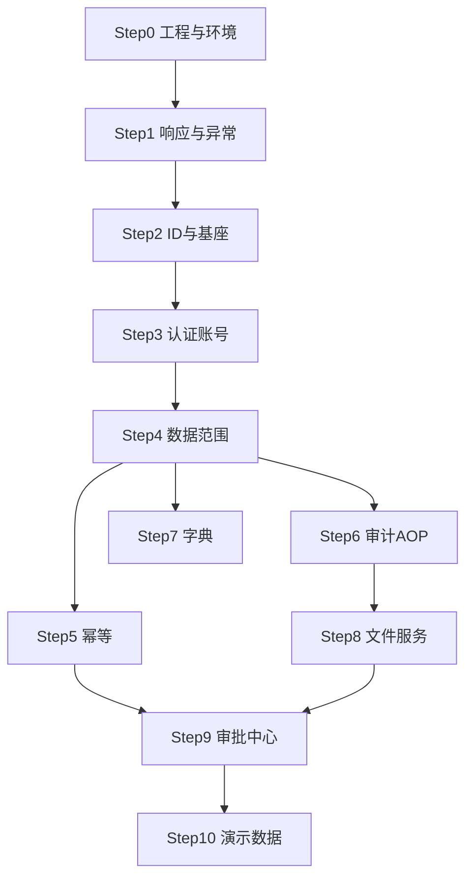

# 后端骨架-开发方案

> 作者：ZCode（方案架构师）｜创建时间：2026-10-07 23:55｜复核修订：2026-10-07
> 状态：**已批准（2026-10-08）**，由开发会话按步骤执行，每步独立 commit 走分支与 PR；开工前置见 Step 0（接口先行）；推送远端每次须组长单独授权
> 2026-10-08 注记：新方向（微服务、论坛、优先级调整）已落入本方案 v0.3（§2.1 工程形态、Step 0 多模块初始化、Step 3 JWT 约定），方向全貌见 2026-10-08/微服务拆分与论坛-架构调整方案.md
> 依据：《全局接口与开发规范》、docs/db/initsql.sql（52 表）、PRD §3.1 认证、§3.9 审批中心、§5 非功能

## 0. 开工前必须拍板的契约冲突（5 项，组长决策）

复核方案与《规范》《PRD》《表结构》后，发现 5 处两两冲突。它们都落在**全组公共约定**上，开工后才暴露就是 7 个人一起返工，所以必须先定。

| 编号 | 冲突点 | 规范 / PRD 侧 | 本方案侧 | 处置建议 |
|------|--------|---------------|----------|----------|
| K1 | 表结构唯一真相源 | initsql.sql 头注明"全项目仅此一份表结构定义" | Flyway V1 禁改，改表只新增 V2+ | 见 §0.1 |
| K2 | 后端包结构 | 规范 §8.1：模块内分层 | Step 0：全局分层 | 见 §0.2 |
| K3 | 幂等命中语义 | 规范 §6：重复键直接返回首次结果 | Step 5：命中返回 1005 | 见 §0.3 |
| K4 | 账号服务端点归属 | 规范 §3.1 责任田无 /api/users | Step 3 对外暴露 /api/users | 见 K4 行下方 |
| K5 | 本地容器数量 | PRD §5 部署：Compose 启动 6 容器 | Step 0：本地三容器 | 见 K5 行下方 |

K4 处置建议：账号服务**不新增 /api/users 责任田**。A 线 M13 是 `POST/PUT /api/members/{id}/account`，路径归 A；骨架只对外提供 `service.AccountService`（进程内方法），HTTP 面由 A 线出。若确需独立端点，则挂在 `/api/auth` 下（`/api/auth/users/{id}/login-name`），并同步写入规范 §3.1。

K5 处置建议：本地开发 3 容器（mysql + minio + clamav）够用，PRD 的 6 容器含前端 nginx、AI 服务与备用位，属于**生产部署口径**。在规范 §8.3 补一句"本地开发 3 容器 / 生产 6 容器"，避免后端同学以为漏了服务。

### 0.1 表结构真相源怎么定（K1，最关键）

现状是**双真相源**：initsql.sql 说"改表直接改本文件"，方案说"V1 禁改只增 V2+"。两条路同时走，必然漂移——有人改了 initsql.sql 忘了写 V2，别人克隆项目 Flyway 建出的库就缺字段，且这种错误要到联调才炸。



**推荐方案**：Flyway 迁移脚本为**运行时真相源**，initsql.sql 降级为"人工建库与评审用的全量快照"。改表固定三步，缺一不可：

1. 新增 `V2__xxx.sql` 增量脚本（禁改 V1）
2. 同步更新 initsql.sql 全量（保持一致）
3. 组长批准

**备选方案**（不推荐）：弃用 Flyway，启动时直接执行 initsql.sql。简单，但没有版本演进能力，后期改表只能手工 ALTER，7 人协作必然失控。

### 0.2 幂等命中语义（K3）

规范 §6 写"重复键直接返回首次结果"，但 `idempotent_record` 只有 `result_summary VARCHAR(500)`——存不下首次响应体，这句话用这张表实现不了。这是**规范文字与表结构的冲突**，不是方案的问题。

- 推荐：命中返回 `1005`（方案现写法），同时把规范 §6 措辞修订为"重复键直接拦截并返回 1005"
- 若要真"返回首次结果"，需给表加 `result_body` 字段或引入外部缓存，本期不值得

### 0.3 后端包结构（K2）

规范 §8.1 说"`com.viomanager.{模块}` 内分 controller/service/mapper/entity/dto"，方案 Step 0 说全局分层。两者都对一半：

- **基座类跨模块复用**，硬塞进某个业务模块不合理 → `com.viomanager.common.*`、`com.viomanager.config.*` 全局放
- **业务类必须按模块隔离**，否则 7 个人往同一个 service 包里塞文件必然冲突 → `com.viomanager.{模块}.{controller,service,mapper,entity,dto}`

2026-10-08 按 K2 组长表态定稿（业务严格按模块）：业务代码一律落各自模块包；基座不再以“全局包”形式存在，改为独立版本化的 vio-common jar（骨架专属领地，见 §2.1）；规范 §8.1 措辞随下次修订同步。

## 1. 目标与边界

**目标**：从零生成 `backend/` 工程，搭完全组公共底座（认证、数据范围、幂等、审计、文件、字典）+ 组长业务模块（审批中心），让 A/B/C 线与其余成员只写各自业务代码。

**本期不做**（写进方案防止跑偏）：

- AI 助手对话实现（`ai_` 表已建，前端入口默认停用，后续单独立方案）
- Redis 缓存（当前量直查库足够，二期预留）
- Canal / binlog 订阅（二期必做项；本期仅 MySQL 显式启用 binlog ROW 格式、保留 14 天）
- Nacos / Sentinel / Seata / Spring Statemachine（已拍板不用）
- 比赛来源爬虫抓取任务（接口留位）
- Swagger / springdoc 注解（Apifox 是唯一接口真相源）

## 2. 技术选型（已拍板，不再讨论）

| 项 | 选择 | 说明 |
|----|------|------|
| 框架 | Spring Boot 3.5.5 + Java 21 | 构建时 JAVA_HOME 指向 `~/.jdks/temurin-21.0.12.1` |
| ORM | MyBatis-Plus | 52 表映射、逻辑删除、审计字段自动填充、乐观锁插件 |
| 认证 | jjwt + 自研 OncePerRequestFilter | 不引 Spring Security 全家桶；BCrypt 取自 spring-security-crypto |
| 建表 | Flyway（V1__init_52_tables.sql） | 克隆即建表；改表只允许新增 V2+ 脚本，禁改 V1（见 §0.1） |
| 对象存储 | MinIO Java SDK | 图片与业务文件统一走 file_object |
| 病毒检测 | ClamAV（ClamD 协议） | 结果落 file_object.scan_status，命中拒绝+审计 |
| 本地环境 | docker compose：mysql8 + minio + clamav | MySQL binlog ROW、保留 14 天；容器数口径见 K5 |

### 2.1 工程形态（微服务化后的骨架写法，2026-10-08 增）

骨架从单应用改为 **Maven 多模块，一父两子起步**：

```
backend/
├── pom.xml            父工程，统一锁 Spring Boot 与依赖版本
├── vio-common/        底座 jar：无业务无数据库，放骨架公共组件
├── vio-management/    管理系统服务，阶段1 唯一可运行服务
└── vio-forum/         阶段2 才创建，现在不建空壳
```

- 包名与规范 §8.1 保持一致：common 的类在 `com.viomanager.common.*`，管理系统业务在 `com.viomanager.{模块}.*`，启动类放 `com.viomanager` 根包，一次扫描同时带上 common 与本服务模块；论坛阶段2 同理，靠 classpath 隔离互不串扰
- **vio-common 不是被否掉的全局包**：它是独立版本化的 jar 依赖，只有骨架负责人能改，业务代码禁止进入。A/B/C 三线照旧只在 vio-management 的各自模块包里开发，日常体感不变
- **步骤落点**：Step 1 响应异常 / Step 2 基座字段 / Step 5 幂等 / Step 6 审计的实现落 vio-common（阶段2 论坛直接复用）；Step 0、3、4、7、8、9、10 落 vio-management
- common 里的 JWT 过滤器预留扩展点：改密时间校验与停用校验是管理系统侧的装配项，论坛阶段2 只挂验签，不查库
- common 组件用根包扫描加薄配置显式装配，不用 spring.factories 自动装配那套，排查问题看得见
- **单仓库**：所有服务同一 git 仓库，跨服务契约一个 commit 改完，不做多仓
- **边界现在定死，容器按阶段长**：阶段1 compose 仍三容器，网关、Redis、论坛容器全部等阶段2

### 2.2 代码注释与预留规范（组长要求，2026-10-08 增）

开发会话每步遵守，PR 审核按此检查：

- **基本注释**：类头一句话写职责；方法写清干什么（公开方法用 Javadoc，含关键参数与返回值）；超过一屏或含业务规则的代码块，开头写这段在干什么。注释写实现意图与约束，**接口文档（路径/参数/响应/错误码）不进注释**——Apifox 是唯一真相源，两处写必然漂移
- **预留占位**：本期不做但已规划的，留空方法占位并标 `TODO(阶段X)：做什么 + 谁负责`；以后要完成的**先定义 Java 接口**，Javadoc 写清设计意图，实现给空壳（审批兜底 Handler 即此模式）。只预留方案里写过的，不预留猜的
- **重点标注（组长指定，着重标）**：

| 标注 | 用在 |
|------|------|
| `// ⚠️ 难点：` | 设计或算法复杂、理解成本高 |
| `// ⚠️ 并发：` | 高并发场景、竞态窗口（如幂等键唯一约束竞争、计数异步落库丢失窗口） |
| `// ⚠️ 安全：` | 越权封堵、敏感数据、易被攻破点（如 orgId 只能取自 CurrentUser，禁止信前端） |
| `// ⚠️ 冲突：` | 多人协作易踩的公共约定点 |

标注要写"为什么危险、改了会怎样"，示例：

```java
// ⚠️ 并发：两人同时点批准，靠 status=PENDING 的条件更新保证只有一个成功；返回 0 行必须抛 6001，否则回调双倍执行
int updated = mapper.casUpdateStatus(id, PENDING, APPROVED);
// ⚠️ 安全：审批组织只能取自 CurrentUser，禁止信任请求参数——否则跨部门越权审批
```

- 注释计入行数，文件超 300 行照拆——注释要求不是放宽拆分标准的理由
- **代码风格朴素直白（组长要求，2026-10-08 增）**：不用 Stream API / 方法引用（用 for 循环 + StringBuilder）、不用 record / var / switch 表达式、不用 Map.of（用 HashMap 逐个 put）；lambda 只在框架接口强制处出现并注释说明；框架契约代码（如 MetaObjectHandler）无法简化时，注释用人话讲原理；命名完整不缩写，一行一个动作
- **风格基准 = 组长的 hm-dianping 代码（组长指定，2026-10-08 增）**：Lombok（@Data/@Accessors/@Slf4j）、@Resource 注入、I 前缀接口 + Impl 后缀 + extends ServiceImpl、薄 Controller、编号步骤注释（//1. //2. //5.1）、校验失败 return Result.fail、BeanUtil 拷贝、复杂逻辑人话注释带例子；Step 3 起执行，与规范契约冲突处以契约为准

## 3. 开发步骤（10 步，每步可独立验证）

**步进执行纪律（组长要求，硬性）**——每一步按固定节奏走：

1. 开工前打基线：`git tag step-N-baseline`
2. 开发 + 自测该步的"验证"项；**只做本步，不顺手做下一步**
3. 验证**通过**：在 `feature/backend-skeleton` 分支上独立 commit（`feat(骨架): StepN 内容`）→ 发 PR 到 main → **停下向组长汇报，组长在 GitHub 审核并点 Merge 即放行进入下一步**（审核含 §2.2 注释与 ⚠️ 标注检查）
4. 验证**不过**：立即回滚——分支上未推送的改动 `git reset --hard step-N-baseline`；已合入 main 的用 `git revert`（main 禁 force push）——修复思路后重做，**绝不带病前进**
5. 数据库特例：Flyway 脚本一经执行不回滚，修错只走新增 V2+ 脚本或本地重建（`docker compose down -v && up`，本地库重建零成本）

### Step 0 环境与工程初始化
- **前置**：骨架接口清单（2026-10-08/骨架-公共服务-接口清单.md）经组长批准并录入 Apifox——铁律 2 接口先行，代码对着接口定义写。Step 0–2 无对外业务接口（仅 health），清单审批期间可先行；Step 3 起严格以清单为准
- `backend/` Maven 多模块工程，结构按 §2.1：父 pom + vio-common + vio-management（两个模块先立空壳，common 的内容由 Step 1 起填充）
- 包结构按 §0.3 定稿（K2：业务严格按模块）：vio-management 内业务按模块分包 `com.viomanager.{模块}`，基座类在 vio-common 的 `com.viomanager.common.*`
- `docker-compose.yml`（本地三容器）；`application.yml` 数据源/MinIO 全走环境变量，`.env.example` 入库
- 启 gzip 压缩（PRD §5 性能要求，SSE 路径排除）
- Flyway 首版脚本放 vio-management：由 `docs/db/initsql.sql` 转换（去掉 CREATE DATABASE / USE / SET FOREIGN_KEY_CHECKS 行）
- **验证**：`docker compose up -d` → `mvn install` 后 vio-management 能正常依赖 vio-common → `mvn spring-boot:run -pl vio-management` → 日志显示 Flyway 建 52 表 → `GET /api/health` 返回统一响应体 `code=0`

### Step 1 统一响应与全局异常
- `Result<T>{code,message,data}`、`BizException(code,message)`、`@RestControllerAdvice`：BizException 透传业务码；参数校验失败统一 1001；兜底 1000 且记录完整堆栈
- `CommonErrorCode` 枚举 1001–1007（对齐规范 §4）
- **骨架自带两段业务码**（规范 §4 把 2xxx、6xxx 划给组长，方案此前漏写，本步补齐占位）：
  - `2001` 登录名或密码错误 / `2002` 账号已停用 / `2003` 登录名已存在 / `2004` 原密码不正确
  - `6001` 审批单不存在或已处理 / `6002` 无权处理该审批 / `6003` 当前审批状态不允许该操作
  - 两段独立成枚举文件（`AuthErrorCode`、`ApprovalErrorCode`），不塞进 CommonErrorCode
- **验证**：单测抛 `BizException(6001)` 断言响应体；curl 缺参断言 `code=1001`

### Step 2 ID 与基座字段
- MyBatis-Plus：雪花主键、`@TableLogic` 逻辑删除、`MetaObjectHandler` 自动填充 created/updated 四字段
- **验证**：插一条数据四字段自动有值；逻辑删除后默认查询不可见
- 已知边角：唯一键用 `(业务列, deleted)` 组合，同一业务值只能存在**一条**已删行，二次删除同值会撞唯一键。本步不处理，登记为已知限制

### Step 3 认证与账号（/api/auth）
- 接口：`POST /api/auth/login`（成功返回 token + 是否仍为默认密码标记；失败记 `sys_login_log`）、`PUT /api/auth/password`（改密后旧 token 全失效）
- 账号管理（改登录名、重置密码）按 K4 结论：**骨架只提供 `AccountService` 进程内方法**，HTTP 面由 A 线 M13 出；若组长选择独立端点则挂 `/api/auth/users/*` 并同步规范 §3.1
- 机制：JWT 载荷 `userId role orgId realName pwdUpdatedAt`，时效 2 小时（为阶段2 论坛只验签不查库预留，见 2026-10-08 架构调整方案 §4）；JWT 过滤器实现放 common 并留扩展点，管理系统装配「验签 + 比对 `pwd_updated_at`（改密即失效）+ 校验 `status=1`（停用即拒绝）」；密码 BCrypt；初始密码 abc123 触发改密提示
- **验证**：curl 全流程——登录拿 token → 带 token 访问 200 → 篡改 token 1002 → 改密 → 旧 token 变 1002 → 停用账号 → 1002

### Step 4 数据范围（org 子树）
- ThreadLocal `CurrentUser`；`@DataScope` 注解 + MyBatis 拦截器：超管不加过滤；部门管理员按 `sys_org.path` 子树注入
- 学生范围**默认拒绝**：拦截器遇到 role=STUDENT 且业务查询未显式声明 `@DataScope(scope=SELF)` 时，直接抛错而非放行——防止某条线忘加"本人参与"条件就泄露全量数据
- 提供 `OrgPathUtil`（A 线建组织时维护 path 用）
- 提供**仅 dev 生效**的探针接口 `GET /api/dev/scope-probe`（返回当前用户解析出的数据范围与命中条数），供本步验证使用，Step 10 收尾时确认其被 profile 关掉
- **验证**：三个角色账号调探针接口，断言范围 全部 ⊃ 本部门 ⊃ 本人

### Step 5 幂等拦截
- `@Idempotent` 注解 + 拦截器；`X-Idempotency-Key` 落 `idempotent_record`（request_hash 识别同键不同参的异常使用）；命中返回 1005（见 §0.2）
- **验证**：同 key 二次请求返回 1005；过期后 key 可复用

### Step 6 审计 AOP
- `@AuditLog(bizType, summary SpEL)`；异步写 `audit_log`
- **字段填充映射**（"字段齐全"的判定标准，避免各写各的）：

| audit_log 列 | 来源 |
|--------------|------|
| user_id / login_name / real_name / role / org_id | CurrentUser（匿名登录失败场景为空） |
| ip | X-Forwarded-For 逐跳解析，取首个非内网地址 |
| user_agent / http_method / uri | 当前请求 |
| biz_type / biz_type_label | 注解值 + 枚举中文名 |
| summary | SpEL 模板渲染结果 |
| request_params | 请求体摘要；敏感接口（身份证、密码相关）留空 |
| success / error_message | 环绕捕获 |
| cost_millis | 环绕计时 |

- **验证**：调注解接口后 audit_log 新增一行，上表每列均有值；开关前后接口耗时对比可忽略

### Step 7 字典服务
- `GET /api/dicts/{code}`；本期直查库（表有索引、量小）
- **验证**：SKILL 字典能返回预设项 + 用户补充项（含审核状态）

### Step 8 文件服务（/api/files）
- 接口：`POST /api/files`（multipart，返回 fileId + scanStatus）、`GET /api/files/{id}/download`（鉴权流式，不暴露对象地址，写下载审计）
- 机制：MinIO putObject → ClamAV 扫描 → CLEAN 放行 / INFECTED 拒绝 + 审计；biz_type/biz_id 关联
- 扫描不可用时的 `UNAVAILABLE` 状态按 §7 待确认项取值（表已预留该枚举）
- **验证**：传普通文件成功；传 EICAR 标准测试样本被拒、file_object 记 INFECTED、audit_log 有记录

### Step 9 审批中心（/api/approvals）
- 接口：`GET /api/approvals`（三视角：我的待办 / 我发起的 / 我是目标人）、`POST /api/approvals/{id}/approve|reject|cancel`、`POST /api/approvals/{id}/agree|refuse`（目标人）、`PUT /api/approvals/read`、`GET /api/approvals/unread-count`
- 已读标记对齐表结构：`approval` 有 `applicant_read / target_read / approver_read` 三个标记，按当前用户视角只置其中一个，`PUT /read` 收 body `{ids:[], asRole:APPLICANT|TARGET|APPROVER}`
- 过期时长按 §7 待确认项取值，定时任务扫 `expire_at` 转 EXPIRED
- 机制：
  - 内部服务 `createApproval(bizType, bizId, payload快照, applicant, target, org)` 供各线调用
  - **回调注册表**：各线实现 `ApprovalHandler` 接口（onApproved / onRejected）注册为 Bean，审批中心按 bizType 路由，事务内执行，按 biz_id 幂等（对应规范"进程内回调不走 HTTP"）
  - `approval_record` 每个动作记流水
- 已登记 biz_type：TEAM_CREATE、TEAM_ADD_MEMBER、TEAM_REMOVE_MEMBER、TEAM_ADD_ADVISOR、TEAM_DISSOLVE、ACHIEVEMENT_SUBMIT、PROJECT_VIEW、MILESTONE_APPROVE、SEMESTER_SWITCH。骨架提供**空实现兜底 Handler**（记录日志不动作），避免某线未注册时审批通过后静默丢失
- **验证**：单测走 TEAM_CREATE 模拟全流程——提交 → 待办出现 → 批准 → 回调执行建队 → 红点归零；驳回 / 取消 / 目标人拒绝分支各自通过

### Step 10 演示数据与收尾
- `R__demo_data.sql`（Flyway repeatable）：5 个账号（超管 1 + 部门管理员 2 + 学生 2）、组织树含 2 个分子组织、1 学期、1 模板 + 1 比赛、2 赛队、1 条获奖记录（PRD §5 要求）
- repeatable 脚本**每次校验和变化都会重跑**，必须写成幂等插入（固定 ID + `INSERT ... ON DUPLICATE KEY UPDATE`），否则第二次启动撞主键
- 上线检查清单：强制改 admin 初始密码、JWT 密钥必须走环境变量、确认 dev 探针接口已关闭
- **验证**：全新库一键起环境，演示账号登录走通"登录 → 建队申请 → 审批通过 → 材料状态"主链路

## 4. 步骤依赖关系



Step 5/6/7 三件互相独立，可并行推进。

## 5. 对其他线的交付时间表

| 交付物 | 谁在等 | 目标 |
|--------|--------|------|
| Step 0–2（工程+异常+基座） | 全组 | 第 1 周前半 |
| Step 3 认证 + Step 4 数据范围 | 全组（A 线还要账号服务） | 第 1 周后半 |
| Step 8 文件服务 | A 线（证件照）、C 线（材料佐证） | 第 2 周前半 |
| Step 9 审批中心 + ApprovalHandler 接口 | B 线（组队）、C 线（成果）、A 线（学期切换） | 第 2 周后半 |

## 6. 需求清单

- [ ] §0 五项契约冲突已拍板（K1–K5）
- [ ] Step 0–10 全部完成且逐项通过"验证"栏
- [ ] 每步严格遵守步进执行纪律：tag 基线 → 验证 → 通过须组长确认才前进 / 失败即回滚
- [ ] 每步在 `feature/backend-skeleton` 分支独立 commit 并以 PR 合入 main（组长点 Merge = 放行）
- [ ] 单文件不超过 300 行
- [ ] 通用错误码 1001–1007 与规范一致，2xxx/6xxx 骨架码表独立成文件
- [ ] 敏感操作（身份证、下载）审计日志逐条可查
- [ ] 演示数据与 PRD §5 一致

## 7. 待确认事项

> 2026-10-08 拍板记录：方案 v0.3 批准开工；K1 定 Flyway（V1 为运行时真相源，initsql.sql 同步为快照），K2 前次已定（业务严格按模块）。K3/K4/K5 未单独拍板，按方案默认值执行（已告知组长无异议），对应 Step 开工前逐条复核。开工时点：等组长侧接口清单定稿入 docs/api/。推送远端每次须组长单独授权。

- [x] (已确认 2026-10-08) **K1 表结构真相源**：Flyway 为准 + initsql.sql 同步
- [x] (已确认 2026-10-08) **K2 包结构**：业务严格按模块，基座落 vio-common
- [ ] (需用户确认) **K3 幂等命中**：返回 1005 并修订规范 §6 措辞（推荐）
- [ ] (需用户确认) **K4 账号服务**：仅进程内 AccountService，HTTP 面给 A 线（推荐）
- [ ] (需用户确认) **K5 容器数**：本地 3 / 生产 6，写入规范
- [ ] (需用户确认) 规范 §2.2 响应示例写 `4003 队名已存在`，与 B 线清单 `4002 队名已存在` 冲突——需组长改规范示例（B 线的 4003 是队伍人数超上限）
- [ ] (需用户确认) 审批单过期时长（表有 expire_at，未定期限；建议 7 天）
- [ ] (需用户确认) ClamAV 不可用时（UNAVAILABLE）：拒绝并提示（推荐，PRD 说强制检测），还是放行记 UNAVAILABLE
- [ ] (需用户确认) 演示数据 5 账号构成：超管 1 + 部门管理员 2 + 学生 2
- [ ] (需用户确认) 审批回调采用进程内 `ApprovalHandler` 接口注册机制（B/C/A 线各自实现），不走 HTTP
- [ ] (需用户确认) 幂等键过期时长 24 小时
- [ ] (需用户确认) 演示数据组织数：PRD §5 写"1 个组织"，方案给 2 个分子组织（子组织排班需要），是否接受

## 变更记录

| 版本 | 日期 | 说明 |
|------|------|------|
| v0.1 | 2026-10-07 | 初稿，10 步骨架方案 |
| v0.2 | 2026-10-07 | 复核：新增 §0 五项契约冲突与处置建议；补 2xxx/6xxx 骨架错误码；修 Step 3/4/5/6/9 路径与字段口径；补 gzip、dev 探针、演示数据幂等；待确认扩到 12 项 |
| v0.3 | 2026-10-08 | 微服务化改写：新增 §2.1 工程形态（Maven 多模块 vio-common + vio-management）；Step 0 重写为多模块初始化；Step 3 JWT 载荷加 realName、时效 2 小时、过滤器留扩展点；§0.3 按 K2 组长表态定稿 |
| v0.3.1 | 2026-10-08 | Step 0 增加接口先行前置：骨架接口清单批准并录 Apifox 后，Step 3 起才对接口径开工 |
| v0.3.2 | 2026-10-08 | 新增 §2.2 代码注释与预留规范（组长要求）：基本注释、TODO 占位与接口预定义、⚠️ 难点/并发/安全/冲突 四类重点标注、注释计入 300 行；步进纪律第 3 条挂注释检查 |
| v0.4 | 2026-10-08 | 组长批准 v0.3：K1 定 Flyway；K3/K4/K5 未单独拍板、按默认执行且对应 Step 开工前逐条复核；记录推送远端逐次授权；开工首个会话只做 Step 0 |
