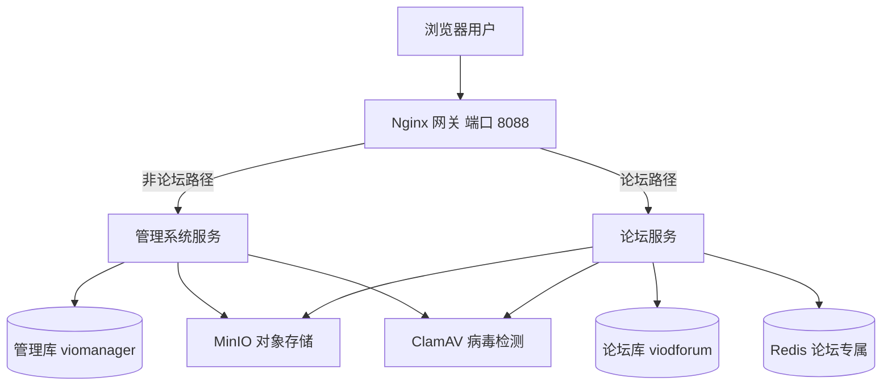
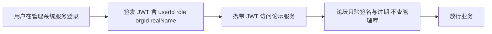
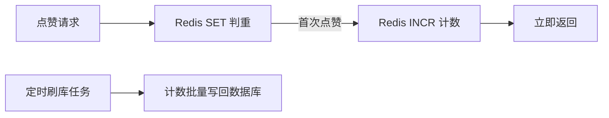

# 微服务拆分与论坛-架构调整方案

> 作者:ZCode（方案架构师） | 创建时间:2026-10-08 09:47
> 状态:待组长批准。本方案只定架构边界与路线图,不改任何 docs 契约文件
> 背景:组长传达新方向——开发优先级调整为 管理系统 → 论坛 → 知识库与AI助手;架构改微服务;管理系统与论坛各用一个数据库;AI 助手接入 GLM

## 1. 先回答三个直接问题

| 问题 | 结论 |
|------|------|
| 论坛需求之前入过库吗 | 没有。已全库检索,PRD 规范 接口清单 52表 均无论坛字样。最接近的是 PRD 3.12 技术交流,但那是管理员推送的内容流,不是互动论坛。论坛是全新需求,功能范围从未定义 |
| 管理系统和论坛各用一个数据库对吗 | 对。独立服务配独立库是微服务的基本边界,方向正确。落地推荐:同一个 MySQL 容器里建两个 database 起步,物理拆实例留到有真实压力时再做,连接串全走环境变量随时可拆 |
| AI 用 GLM 有没有架构冲突 | 没有。PRD 预留的就是任意 OpenAI 兼容 LLM 配置位,GLM 走 OpenAI 兼容协议正好落进去。只需把默认值从 Ollama 本地模型改为 GLM,属于 PRD 小修订 |

## 2. 服务拆分总体架构

要点:

- **两个 Spring Boot 独立进程,各自独立库,互不跨库查询**。跨服务需要对方数据时只允许两种方式:JWT 载荷自带身份字段,或内部 HTTP 接口。禁止 JOIN 对方的库
- 阶段1 只有管理系统一个服务,不需要网关,直接跑 8088;阶段2 论坛上线时引入 Nginx 按路径转发
- MinIO 与 ClamAV 是共享基础设施。论坛附件走论坛库自己的文件表,对象 key 用 forum 前缀隔离
- Redis 仅论坛服务引入(缓存 计数 热榜),管理系统照旧直查库,骨架不引 Redis 的决策不变;阶段2 起本地 compose 增加 redis 容器,哨兵是生产部署形态
- 知识库与 AI 助手是第三阶段,届时评估独立成第三个服务还是并入管理系统(见 §6)

## 3. 微服务形态选型(关键决策)

上面的要求是用微服务,但微服务有一重一轻两种做法,对 7 人团队 100 到 200 用户规模差异巨大:

| 维度 | 轻量微服务 推荐 | Spring Cloud 全家桶 |
|------|----------------|---------------------|
| 服务发现 | 无,Docker 网络内环境变量直连 | Nacos 注册中心 |
| 网关 | Nginx 按路径前缀转发 | Spring Cloud Gateway |
| 配置中心 | 无,环境变量 | Nacos 配置中心 |
| 分布式事务 | 不引入,靠边界设计避免跨库写 | Seata |
| 熔断限流 | 暂不引入 | Sentinel |
| 额外运维成本 | 一份 docker compose | 多 3 到 4 个中间件容器加学习成本 |

**推荐轻量微服务**:独立进程 独立库 网关路由 共享 JWT。微服务的边界收益(独立库 团队并行 故障隔离)全部拿到,中间件成本最小化。Spring Cloud 那套在当前人数与用户量下,学习与运维成本会吃掉开发主线的时间。若上面明确点名要 Spring Cloud 技术栈本身,需先告知再重评(见 §9 第一条)

## 4. 认证怎么跨服务(单体假设被打破的点)

现有骨架方案 Step 3 的 JWT 设计藏着一个单体假设:**改密后旧 token 失效,靠查询管理库的 pwd_updated_at 实现**。论坛服务若也要查这张表,就破坏了库边界。解法:

- JWT 载荷增加 realName,论坛展示发帖人时不再回查人员档案
- **token 时效缩短到 2 小时**。改密踢人场景靠短时效自然过期兜底,论坛不依赖管理库
- JWT 密钥两个服务共享同一个环境变量,后续加第三个服务同理
- 账号停用踢人:论坛侧接受最长 2 小时延迟;管理端敏感操作仍由管理系统自己查库校验,安全水位不降

## 5. 论坛范围与技术亮点设计(待组长定稿)

组长已明确论坛定位:**简历技术亮点载体,重点做高并发与 Redis 三大问题(缓存穿透 击穿 雪崩)的完整落地**。功能保持克制,技术做深。管理系统侧不受影响,照旧直查库

### 5.1 功能范围(最小可用)

- 版块:管理员维护,如 电控 建模 AI 综合
- 主题帖:标题 正文 附件,登录成员可发
- 回复:楼层式,支持回复某人
- 点赞:帖子和回复均可
- 热帖榜:首页按热度排序展示
- 权限:全部登录成员可见;版块管理 置顶 删帖归管理员
- 暂不做:匿名 私信 富文本编辑器 搜索引擎(先留关键词 LIKE)

### 5.2 Redis 三大问题的落地方案

| 问题 | 论坛场景 | 落地方案 |
|------|----------|----------|
| 缓存穿透 | 恶意刷不存在的帖子 ID,请求绕过缓存直打数据库 | Redisson 布隆过滤器前置拦截,空值缓存短 TTL 兜底 |
| 缓存击穿 | 热帖缓存过期瞬间,并发集中打到数据库 | 热帖详情用逻辑过期加异步重建,普通帖用互斥锁单线程重建,两种都做可讲选型对比 |
| 缓存雪崩 | 首页列表缓存同时过期,或 Redis 整体不可用 | TTL 加随机值打散,Caffeine 本地一级缓存兜底,生产形态上 Redis 哨兵高可用 |

### 5.3 高并发计数与热帖设计

- 点赞与浏览计数走 Redis 原子操作,定时任务批量刷回数据库,数据库不做高频行更新
- 热帖榜用 Redis ZSET,热度公式为点赞数加权加发布时间衰减,读请求不查库
- 帖子列表与详情走 Cache Aside 缓存模式
- 压测验证:JMeter 对帖子详情与点赞接口压测,记录接入缓存前后的 QPS 与 P99 耗时,产出对比报告——简历数字从这里来,经得起追问

点赞链路:

### 5.4 表规划

约 6 张:section topic reply like file_object idempotent_record。topic 增加冗余计数字段 like_count reply_count view_count,由刷库任务维护,线上读走 Redis 不依赖这些字段

### 5.5 技术栈增量(仅论坛服务)

| 项 | 选择 | 用途 |
|----|------|------|
| Redis 客户端 | Redisson | 分布式锁 布隆过滤器 原子计数 |
| 本地缓存 | Caffeine | 一级缓存,雪崩兜底 |
| 压测工具 | JMeter | 产出优化前后对比数据 |

消息队列削峰(发帖回复写入异步化)列为可选加分项,见 §9

与现有 PRD 3.12 技术交流的关系仍需拍板:论坛上线后,技术交流的每日推送是并入论坛(以帖子形式发)还是保留独立模块——影响 tech_ 三张表的归属

## 6. 阶段路线图

- **阶段1 管理系统**:上面要求先做的管理系统就是当前已排的工作,方向不冲突零浪费。骨架方案 10 步全部存活,仅部署拓扑与 JWT 约定按本方案 §3 §4 修订。A B C 三线接口不受影响照常推进
- **阶段2 论坛**:流程为 论坛范围定稿 → 修订 PRD 与表结构契约 → 论坛接口清单 → 开发。开工前把 52 表契约一次性调整到位(tech kb ai 表归属,见 §7)
- **阶段3 知识库与AI**:AI 助手接 GLM 走 OpenAI 兼容协议(智谱云 API 或本地部署 GLM 均可,待定);知识库复用现有 kb_ 表设计;届时评估是否独立第三个服务

## 7. 对现有基线的冲击评估

| 基线文件 | 冲击 | 处置 |
|----------|------|------|
| 后端骨架-开发方案 | 部署拓扑 JWT 载荷 token 时效三处修订 | 修订点已列于本方案 §3 §4,骨架文档头部已加指针注记 |
| 全局接口与开发规范 | 需新增微服务边界 分库约定 网关路由章节 | 组长批准本方案后出规范修订稿,逐条放行 |
| PRD | 优先级调整 论坛新增章节 AI 默认值改 GLM 部署容器数口径 | 同上,一次修订到位 |
| initsql 52表 | tech kb ai 共 8 张表归属待定 | 推荐:阶段1 保持不动,避免三线开工前契约动荡,空表无运行成本;阶段2 论坛定稿时一次性调整 |
| A B C 接口清单 | 无功能影响 | 不动 |
| 工作区 AGENTS.md | 当前状态章节需补一句新方向 | 随规范修订一并更新 |

阶段2 的表调整原则:tech 三张若并入论坛则随论坛库走;kb 五张 ai 两张留在管理库或随阶段3 智能服务走,届时按需定

## 8. 需求清单

- [ ] 组长拍板 §9 待确认条目后,本方案定稿
- [ ] 规范 PRD AGENTS 修订稿出稿并经组长逐条批准(契约文件,须放行后才动)
- [ ] 阶段1 按修订后骨架方案启动,步进纪律不变
- [ ] 论坛表 DDL 与接口清单在阶段2 开工前完成入库
- [ ] 任何跨库访问需求出现时,先回 §2 边界规则评审再动手
- [ ] 阶段2 论坛产出 JMeter 压测对比报告(接入缓存前后 QPS 与 P99),数字可直接写简历

## 9. 待确认事项

- [ ] (需用户确认) 微服务形态按轻量微服务做,Nginx 做网关,不引 Nacos Seata Sentinel——上面是否点名要 Spring Cloud 本身
- [ ] (需用户确认) 论坛功能范围按 §5 最小草案,还是有增删
- [ ] (需用户确认) 技术交流模块并入论坛还是保留独立
- [ ] (需用户确认) token 时效 2 小时,论坛不查管理库,改密踢人接受最长 2 小时延迟
- [ ] (需用户确认) 52 表中 tech kb ai 共 8 张表的归属调整,推迟到阶段2 一次性做
- [ ] (需用户确认) GLM 接入方式:智谱云 API 还是本地部署 GLM 模型
- [ ] (需用户确认) 论坛前端并入现有 Vue 单应用加菜单,还是独立前端工程
- [ ] (需用户确认) 发帖回复是否引入消息队列削峰——默认不引入,点赞浏览计数异步化已由定时刷库覆盖;引入则简历多一个亮点,代价是多一个中间件

## 变更记录

| 版本 | 日期 | 说明 |
|------|------|------|
| v0.1 | 2026-10-08 | 新方向架构调整初稿:微服务拆分 分库 论坛新增 GLM 接入 三阶段路线 |
| v0.2 | 2026-10-08 | 论坛定位升级为简历技术亮点载体:新增 Redis 三大问题落地方案 高并发计数与热帖设计 压测要求,技术栈增量 Redisson Caffeine JMeter |
