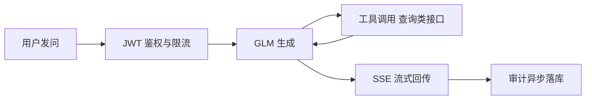

# AI 助手接口清单

> 作者：ZCode（前端会话代拟）｜创建时间：2026-10-23 17:50
> 负责人：组长（骨架域——AI 助手为组长线模块）｜错误码段：**9100–9199**（9xxx 段内；KB 已用 9001–9002，9003–9099 留 KB 扩展与技术交流清单转正）
> 状态：**草案——待组长确认后录入 Apifox；录入后以 Apifox 为准，本文件不再更新**
> 依据：PRD §3.15 AI 智能助手；后端交接提示词 2026-10-21（SSE 流式 + 令牌桶限流 + GLM 接入三件套已拍板）；知识库清单 KB04（提示词联动）
> 设计样张：`.agentdocs/design-preview/2026-10-23-ai-assistant/`（侧栏菜单 + 悬浮球双入口、流式输出、权限裁剪、中断警告，2026-10-23 组长过目中）

## 1. 错误码初始表（9100–9199）

| code | 含义 |
|------|------|
| 9100 | AI 服务未启用（GLM key 未配置零装配，或入口开关关闭） |
| 9101 | 会话不存在或非本人 |
| 9102 | 触发限流（响应头带 `Retry-After: 秒`） |
| 9103 | 上游 LLM 调用失败或超时 |
| 9104 | 生成流中途异常（SSE error 事件载荷，见 §5） |

其余复用 1xxx 通用码：1001 参数 / 1002 未登录 / 1003 权限。

## 2. 定位与总原则

- 服务归**管理系统**（同知识库拍板先例），前端主站壳承载：侧栏一级菜单「AI 助手」+ 右下角悬浮球双入口；PRD「入口默认停用」由 AI09 的 `enabled` 下发控制
- 三端共用一个问答入口，**答案按登录人权限裁剪**；空课查询仅管理角色（PRD）
- 红线（PRD）：**只查不写**——后端工具白名单只注册查询类 Function Calling，不提供任何写操作、审批触发、直连数据库
- 装配口径同 RocketMQ：API key 未配置 = 零装配零 Bean，系统照常跑（可降级是立身之本）



## 3. 聊天核心

| 编号 | 接口 | 说明 |
|------|------|------|
| AI01 | POST /api/ai/chat | 发消息，**SSE 流式响应**（事件契约见 §5）。body：`conversationId`（可空，无会话模式传 null）、`content`（1–500 字）。不挂幂等键：生成型操作天然一次性，断流由前端「重新生成」重发 |
| AI02 | GET /api/ai/status | 探针：`enabled`（装配+开关双条件）、`model`、限流余量（当前窗口剩余次数）。**未装配也回 code 0 + enabled:false**——前端据此灰化入口，不用报错刷屏 |

## 4. 会话管理（PRD 多对话；首版可缓行——待确认①）

| 编号 | 接口 | 说明 |
|------|------|------|
| AI03 | POST /api/ai/conversations | 新建会话，幂等键；标题默认取首问前 20 字，可后改 |
| AI04 | GET /api/ai/conversations | 我的会话列表，更新时间倒序，分页 |
| AI05 | GET /api/ai/conversations/{id}/messages | 消息历史，正序分页，`role = user / assistant` |
| AI06 | PATCH /api/ai/conversations/{id} | 改标题；仅本人，他人会话 → 9101 |
| AI07 | DELETE /api/ai/conversations/{id} | 删除会话；仅本人 |

## 5. SSE 事件契约（AI01 响应体）

```
请求:  POST /api/ai/chat   Accept: text/event-stream
body:  { "conversationId": "9101...", "content": "我这个月的排班是哪几天？" }

事件序列（data 一律 JSON）:
event: meta      data: {"messageId":"...","conversationId":"..."}      ← 首帧，前端落 messageId
event: tool      data: {"name":"queryMySchedule","phase":"start"}      ← 工具调用开始，可多轮
event: tool      data: {"name":"queryMySchedule","phase":"done"}
event: delta     data: {"text":"你"}                                   ← 文本增量，多次
event: done      data: {"finishReason":"stop","usage":{"prompt":123,"completion":456}}
event: error     data: {"code":9104,"message":"..."}                   ← 中途失败，流到此为止
: keep-alive                                                            ← 注释行，每 15s 一次防代理断连
```

- `finishReason`：`stop` 正常结束｜`interrupted` 中断（客户端主动断开、超限截断）→ 前端显示「**回复可能不完整**」（PRD 明确语义）
- 客户端断开连接 → 服务端**立即停止生成**，已生成部分照常落库（会话模式）
- HTTP 层错误（未登录 1002 / 限流 9102 / 未启用 9100）**不走 SSE**：直接标准 Result JSON 返回，前端 http 拦截器统一处理，不进入流
- 断线续传首版不做（见待确认③）：中断即不完整，用户点重新生成

## 6. 安全与审计

- JWT 必须；工具调用**以当前用户身份**执行后端查询接口——数据范围与本人直调该接口完全一致（PRD「转发用户令牌做权限过滤」）
- 每次 chat 异步写审计：`bizType=AI`，摘要 = 首问前 50 字，成功/失败都记（PRD §3.17 所有关键操作含 AI 查询）
- 提示注入防护：工具返回只作数据拼接不执行；系统提示词固定在服务端，不接受前端传入

## 7. 装配与限流

- GLM API key 环境变量注入，**绝不进代码与库**（交接提示词既定）
- 令牌桶（按人）建议值（需确认②）：每人每分钟 **6** 次｜全局并发 **5**｜单次回复上限 **2048** token
- 超限 → 9102 + `Retry-After` 响应头；前端显示「问得太快了，稍等 N 秒」

## 8. 管理侧（仅超管）

| 编号 | 接口 | 说明 |
|------|------|------|
| AI08 | GET /api/ai/admin/config | 读配置：`enabled provider baseUrl model` + apiKey **掩码**（仅尾 4 位，全量永不回显） |
| AI09 | PUT /api/ai/admin/config | 改配置：apiKey 传空 = 保持原值；改后热生效（重建客户端 Bean）；挂审计 |

## 9. 与其他线对接点

- 提示词库：**复用 KB04**（GET /api/kb/prompts），本清单不新增提示词接口
- 审计：挂 `@AuditLog(bizType=AI)`，AQ01 可按 bizType 筛
- 网关：`/api/ai/**` 由管理系统（8088）承载，前端经同源转发，与 KB 同路径策略
- PRD「OpenAI 兼容可切换」由 AI08/09 的 `provider + baseUrl + model` 三元组承载，不侵占系统配置清单

## 10. 前端 mock 口径

- mock 层模拟 SSE：`delta` 分片按 300ms 间隔推送 + `done` 收尾；演示权限裁剪（学生问空课被拒）与中断条（「回复可能不完整」）
- 契约冻结前前端按本清单字段实现，联调拨开关切真——与全站 mock 先行开发同路线

## 11. 待确认事项

- [ ] (需用户确认) **会话历史首版做不做**：不做则 AI03–07 缓行、AI01 `conversationId` 恒空、页面会话栏留位不启用（后端交接提示词亦倾向首版无状态）
- [ ] (需用户确认) 限流三数值（建议：6 次/分、全局并发 5、单次 2048 token）
- [ ] (需用户确认) 断线续传不做——中断即「回复可能不完整」+ 重新生成（简化首版）
- [ ] (需用户确认) 模型切换配置（AI08/09）首版是否实做，或先环境变量写死、接口留位
