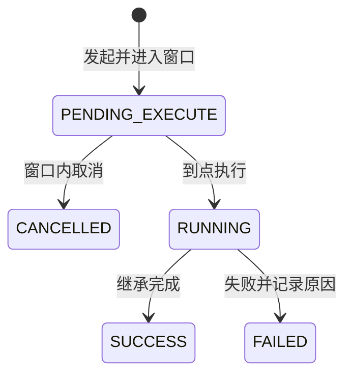

# A 线接口清单——人员档案 + 组织管理 + 学期管理

> 作者：ZCode（方案架构师）｜创建时间：2026-10-07 21:50
> 负责人：A（基础数据线）｜错误码段：3xxx
> 状态：待组长与 A 确认后录入 Apifox；**录入后以 Apifox 为准，本文件不再更新**
> 依据：PRD §3.2 人员档案、§3.3 组织、§3.4 学期；表：sys_org、member、member_skill、sys_dict_type/item、semester、semester_switch_task
> 通用约定（响应体、分页、ID 字符串、时间格式等）见《全局接口与开发规范》，本文不重复

## 0. 前置依赖（组长骨架先交付，A 线才能开工的部分）

- 文件服务：上传返回 fileId（证件照、电子签名走它）
- 账号服务：sys_user 创建、改登录名、重置密码（M13 底层依赖）
- 数据范围注解：组织子树自动过滤
- 字段裁剪组件：§2.3 权限表的统一实现

## 1. 错误码初始表（3xxx，维护在 Apifox 本线目录）

| code | 含义 |
|------|------|
| 3001 | 学号已存在 |
| 3002 | 学号不可修改 |
| 3003 | 该人员是队长，需先解散队伍 |
| 3004 | 不能删除当前登录账号 |
| 3005 | Excel 导入行错误（message 带行号与原因） |
| 3006 | 上级组织不能选自身或其子孙 |
| 3007 | 组织下有子组织，禁止删除 |
| 3008 | 学期名称已存在 |
| 3009 | 学期有关联业务数据，禁止删除 |
| 3010 | 无权查看该敏感信息 |

## 2. 组织管理（/api/orgs，表 sys_org）

| 编号 | 接口 | 说明 |
|------|------|------|
| O01 | GET /api/orgs/tree | 组织树。超管全平台，部门管理员仅本部门子树。节点含 id name orgType isSubOrg managerName leaderName sortNo status level children |
| O02 | POST /api/orgs | 创建。body：parentId name orgType isSubOrg managerId leaderName sortNo。校验 3006 |
| O03 | PUT /api/orgs/{id} | 编辑；改上级同样校验防循环引用 |
| O04 | DELETE /api/orgs/{id} | 有子组织拒绝（3007）；删除后该组织人员 org_id 置空 |
| O05 | GET /api/orgs/{id} | 详情 |
| O06 | GET /api/orgs/colleges | 13 学院 39 专业静态映射（内置生成，不查库），全站学院下拉统一用它 |

## 3. 人员档案（/api/members，表 member / member_skill）

| 编号 | 接口 | 说明 |
|------|------|------|
| M01 | GET /api/members | 列表。筛选：keyword（姓名/学号/手机号模糊）、orgId、memberType、skill、hasAccount。列表项：id name studentNo college major className phone memberType orgName hasAccount idCardLast4 skills。**列表不返回身份证、证件照、邮箱**，进详情 |
| M02 | GET /api/members/{id} | 详情。字段按 §2.3 裁剪：超管/本部门管理员（限本组织子树）全量；本队队长见大部分（身份证走 M10）；本人全量；其他 1003 拒绝（2026-10-23 拍板收紧：学生仅可查本人，原"其他仅姓名/学院/班级/技能"的脱敏视图取消） |
| M03 | POST /api/members | 手工新建（管理员）。studentNo 可空、不可重复（3001） |
| M04 | PUT /api/members/{id} | 编辑。studentNo 不接受变更（3002） |
| M05 | DELETE /api/members/{id} | 队长拒绝（3003）；当前登录账号拒绝（3004）；普通队员删除时清除队伍成员关系；材料/成果等业务记录保留 |
| M06 | GET /api/members/import-template | 13 列 Excel 模板下载 |
| M07 | POST /api/members/import | multipart 上传。学号已存在的行跳过；图片列留空不报错；所属组织按名称匹配，不存在或不唯一该行报错。返回 successCount failCount errors 行号与原因 |
| M08 | POST /api/members/{id}/photo | 证件照上传，覆盖式单图，走文件服务回填 photo_file_id |
| M09 | POST /api/members/{id}/signature | 电子签名上传，覆盖式单图 |
| M10 | GET /api/members/{id}/id-card | 完整身份证号。仅超管/本部门管理员/本队队长/本人；**写审计日志（操作人、时间、IP）** |
| M11 | GET /api/members/{id}/photo 与 /signature | 下载，权限同 M10，写审计 |
| M12 | PUT /api/members/{id}/skills | 更新技能标签；本人或管理员；值来自 SKILL 字典 |
| M13 | POST/PUT /api/members/{id}/account | 管理员绑定账号（登录名默认=学工号、初始密码 abc123、default_password=1）；PUT 改登录名/重置密码（重置后 default_password 回 1）。底层调组长账号服务 |
| M14 | GET /api/members/options | 受限候选搜索（队长流程用，2026-10-23 增）：keyword 模糊（姓名/学号/学工号）、memberType 精确、page/size（size 上限 50，默认 20）；**任意登录角色可用**（B 线队长端原先直调 M01 必 403）；仅返回 id name memberType studentNo jobNo orgId orgName 七字段，无任何敏感列，只含启用状态成员，按姓名排序 |

### 技能字典（SKILL 字典归 A 维护）

| 编号 | 接口 | 说明 |
|------|------|------|
| D01 | GET /api/dicts/SKILL | 字典项列表，含 PRESET 与用户补充项（带 auditStatus） |
| D02 | POST /api/dicts/SKILL/items | 用户补充新技能，audit_status=PENDING |
| D03 | POST /api/dicts/items/{id}/audit | 管理员审核：通过入库 / 驳回 |

## 4. 学期管理（/api/semesters，仅超管）

| 编号 | 接口 | 说明 |
|------|------|------|
| S01 | GET /api/semesters | 列表 |
| S02 | POST /api/semesters | 创建，名称不可重复（3008）。含起止日期、教学周数 |
| S03 | PUT /api/semesters/{id} | 编辑基础信息 |
| S04 | DELETE /api/semesters/{id} | 有关联比赛/赛队/成果/切换任务拒绝（3009） |
| S05 | POST /api/semesters/switch-tasks | 发起切换。body：toSemesterId password（超管密码二次确认）。生成 30 分钟待执行窗口任务 |
| S06 | GET /api/semesters/switch-tasks | 任务列表，含状态与影响快照（待归档比赛数、待继承赛队数、成员关系数） |
| S07 | POST /api/semesters/switch-tasks/{id}/cancel | 窗口内取消 |
| S08 | POST /api/semesters/switch-tasks/{id}/execute | 执行。乐观锁校验 version、进入维护锁定、旧学期归档、未结束比赛/赛队/成员关系继承。**执行引擎由组长骨架提供，A 负责任务管理与界面** |

切换任务状态机：

## 5. 与组长骨架的对接点

- M08/M09/M11 的文件存取全部走 /api/files（组长）
- M13 底层依赖账号服务（组长）；登录、改密、JWT 由 /api/auth（组长）承担，A 不做
- S08 执行引擎由骨架提供；A 提供任务 CRUD 与状态查询

## 6. 待确认事项

- [ ] (需用户确认) M13 挂 /api/members 前缀（A 出接口调组长服务）——本清单默认此方案
- [ ] (需用户确认) 学期切换的维护锁定按 PRD 字面"全员禁止访问"实现，还是"全员只读、禁写"——本清单按全员禁止访问预留
- [ ] (需用户确认) 组织 orgType 枚举是否需要字典化以支持扩展（默认写死枚举）
