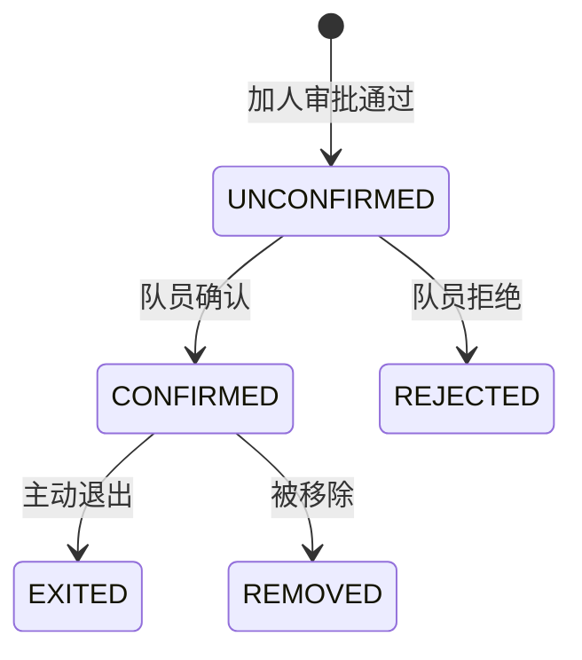

# B 线接口清单——比赛管理 + 赛队管理

> 作者：ZCode（方案架构师）｜创建时间：2026-10-07 21:50
> 负责人：B（赛事主线线，三人中后端最强者）｜错误码段：4xxx
> 状态：待组长与 B 确认后录入 Apifox；**录入后以 Apifox 为准，本文件不再更新**
> 依据：PRD §3.5 比赛、§3.6 赛队；表：contest_template、contest、contest_track、contest_source、team、team_member、team_advisor
> 规则三级继承：模板 default_rules → 比赛 override_rules → 赛道 override_rules（JSON 只存被覆盖的键）

## 0. 规则键名统一表（三级继承的 JSON 键，全组唯一，禁止私自新增）

| 键 | 含义 | 示例值 |
|----|------|--------|
| memberLimit | 每队人数上限 | 5 |
| prefillLimit | 报名时用户自填人数上限 | 5 人队填 2；3 人队见待确认 |
| allowRepeatJoin | 同比赛是否可重复参赛（一人多队） | false |
| crossTeamLeader | 是否允许跨队担任队长 | false |
| maxAdvisorCount | 指导教师数量上限 | 2 |
| crossTrackLimit | 跨赛道限制 | true |

## 1. 错误码初始表（4xxx）

| code | 含义 |
|------|------|
| 4001 | 比赛当前状态不允许该操作（message 指出缺项） |
| 4002 | 队名已存在 |
| 4003 | 队伍人数超上限 |
| 4004 | 重复参赛限制 |
| 4005 | 目标人已在队或已有待审批申请 |
| 4006 | 目标人不是教师类型 |
| 4007 | 同队伍同目标已有待审批申请 |
| 4008 | 非本队成员，禁止访问赛队详情 |
| 4009 | 队伍存在材料/成果/待审批，禁止解散 |
| 4010 | 队长不可自我移除或退出 |
| 4011 | 状态流转不可跳转 |
| 4012 | 模板已被比赛引用，禁止删除 |

## 2. 比赛模板（/api/contest-templates，管理端）

| 编号 | 接口 | 说明 |
|------|------|------|
| T01 | GET /api/contest-templates | 列表（含启用状态、类别筛选） |
| T02 | POST /api/contest-templates | 创建。body：name code category description defaultRules（§0 键名） |
| T03 | GET /api/contest-templates/{id} | 详情 |
| T04 | PUT /api/contest-templates/{id} | 编辑；默认规则变更不影响已创建比赛（比赛创建时快照合并） |
| T05 | DELETE /api/contest-templates/{id} | 被比赛引用拒绝（4012） |

## 3. 比赛实例（/api/contests，管理端创建，学生可查）

| 编号 | 接口 | 说明 |
|------|------|------|
| C01 | GET /api/contests | 列表。筛选 semesterId status。学生仅可见已发布及之后的状态；列表含学期名、状态、报名/比赛起止时间 |
| C02 | GET /api/contests/{id} | 详情。返回**合并后的生效规则**（三级继承计算结果 + 每项来源标注：模板默认/比赛覆盖/赛道覆盖），前端据此显示 是、否、跟随比赛规则 |
| C03 | POST /api/contests | 创建。body：templateId semesterId name 报名/比赛起止 联系人 描述 overrideRules |
| C04 | PUT /api/contests/{id} | 编辑 |
| C05 | DELETE /api/contests/{id} | 仅 DRAFT 状态可删 |
| C06 | POST /api/contests/{id}/status | 状态流转。body：to。按序流转不可跳转（4011）；发布前检查：基础信息完整、规则已配置、需要赛道则已配赛道、需要材料则已配材料要求（4001 message 逐项指出） |
| C07 | POST /api/contests/{id}/tracks | 添加赛道。body：name code overrideRules description |
| C08 | PUT /api/contests/{id}/tracks/{trackId} | 编辑赛道（含赛道级规则覆盖） |
| C09 | DELETE /api/contests/{id}/tracks/{trackId} | 有赛队挂载该赛道时拒绝 |

比赛状态机：DRAFT → PUBLISHED → REGISTERING → RUNNING → FINISHED → ARCHIVED（学期切换时已结束比赛自动归档，任务逻辑非接口）。

## 4. 待处理比赛池（/api/contests/pool，PRD §3.5 自动收集）

| 编号 | 接口 | 说明 |
|------|------|------|
| P01 | GET /api/contests/pool | 待处理列表。筛选 status；展示标题、来源、抓取内容、解析出的时间与规则线索 |
| P02 | POST /api/contests/pool/{id}/confirm | 确认为正式比赛：按解析内容预填创建 contest，confirmed_contest_id 回填 |
| P03 | POST /api/contests/pool/{id}/ignore | 忽略 |

外部来源登记（爬虫/RSS/手工）与定时归集由后端任务完成，不走 HTTP 接口。

## 5. 赛队（/api/teams）

| 编号 | 接口 | 说明 |
|------|------|------|
| TE01 | GET /api/teams | 列表。超管全部；部门管理员本部门；**学生仅自己所在的队伍**。含 materialStatus、materialCompleteRate |
| TE02 | GET /api/teams/{id} | 详情。仅本队成员、管理端、指导教师可见；其他人 4008（封堵按 ID 枚举越权） |
| TE03 | POST /api/teams | 发起组队申请。body：contestId trackId name projectName prefillMemberIds。校验：比赛处于 REGISTERING、队名同比赛唯一（4002）、allowRepeatJoin、crossTeamLeader、prefillMemberIds 不超 prefillLimit；通过校验后生成 TEAM_CREATE 审批单（走组长审批中心），**不直接建队** |
| TE04 | POST /api/teams/{id}/members | 队长加人申请。body：memberId。校验人数上限（4003）、重复参赛（4004）、目标人身份、同队待审批（4005/4007）；生成 TEAM_ADD_MEMBER 审批；**审批时按最新成员关系复核**（封堵两队同时邀请同一人的时序漏洞）；通过后成员状态 UNCONFIRMED |
| TE05 | GET /api/teams/{id}/members/search | 姓名模糊搜索可加队员（前端防抖 300ms）；返回 inTeam 标记供置灰 |
| TE06 | POST /api/teams/{id}/members/{memberId}/confirm | 目标队员本人确认或拒绝。body：action 取 CONFIRM 或 REJECT |
| TE07 | DELETE /api/teams/{id}/members/{memberId} | 移除成员（队长或管理端；软删保留历史）；队长不可被移除（4010）；**默认走 TEAM_REMOVE_MEMBER 审批** |
| TE08 | POST /api/teams/{id}/exit | 非队长主动退出；队长在审批中心收红点通知 |
| TE09 | POST /api/teams/{id}/advisors | 加指导教师申请。仅允许 member_type=TEACHER（4006）；TEAM_ADD_ADVISOR 审批；通过即生效（只读、权限不低于队长） |
| TE10 | DELETE /api/teams/{id}/advisors/{advisorId} | 移除指导教师 |
| TE11 | GET /api/teams/{id}/members | 成员列表。**字段裁剪**：队长、指导教师见成员完整信息（身份证走 A 线 M10）；**队员仅见自己和队伍公开信息**（队名、项目名、比赛名、状态） |
| TE12 | POST /api/teams/{id}/dissolve | 解散。body：reason。有材料/成果/待审批拒绝（4009）；解散后成员收红点通知 |
| TE13 | PUT /api/teams/{id} | 队长编辑队名/项目名（同比赛队名唯一 4002） |

成员状态机：

## 6. 与组长审批中心对接

- B 线产生审批单 biz_type：TEAM_CREATE、TEAM_ADD_MEMBER、TEAM_REMOVE_MEMBER、TEAM_ADD_ADVISOR（payload 为申请快照）
- 组长审批通过后**进程内调用** B 线 Service 执行建队/加人/移除（不走 HTTP）；B 线按 biz_id 唯一约束保证幂等
- 审批被拒/取消时 B 线无需动作（正式数据从未创建）

## 7. 待确认事项

- [ ] (需用户确认) **3 人队 prefillLimit 是 1 还是 2**——PRD §3.5 与 §6 变更记录矛盾，本清单暂按 1 预留
- [ ] (需用户确认) 队长变更/转让：PRD §2.2 提到"队长变更"但 §3.6 无流程，默认本期不做（需要则补 TE14 transfer-leader）
- [ ] (需用户确认) TE07 移除队员的审批人与加人一致（本部门管理员）
