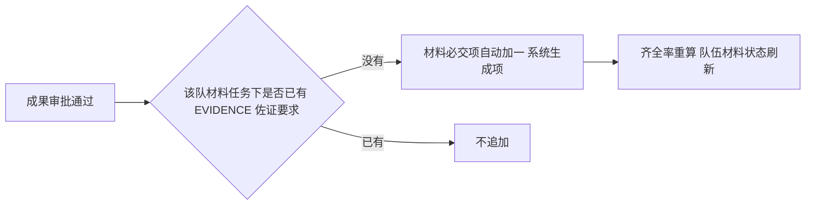

# C 线接口清单——材料管理 + 成果管理

> 作者：ZCode（方案架构师）｜创建时间：2026-10-07 21:50
> 负责人：C（材料成果线）｜错误码段：5xxx
> 状态：待组长与 C 确认后录入 Apifox；**录入后以 Apifox 为准，本文件不再更新**
> 依据：PRD §3.7 材料、§3.8 成果；表：material_task、material_requirement、material_submission、achievement、achievement_file
> 前置依赖：B 线队伍/比赛数据（提交校验）、组长文件服务（/api/files）、组长审批中心（ACHIEVEMENT_SUBMIT）
>
> 📌 **2026-10-13 更新：本文件已按 feature/c-line-material-achievement 分支的实际实现更新；
> 按规范，录入 Apifox 后以 Apifox 为准。**（MS03 路径变更、MR04 补录、1006 截止码、待确认追加等，详见各节与 §7）

## 1. 错误码初始表（5xxx）

| code | 含义 |
|------|------|
| 5001 | 文件格式不允许 |
| 5002 | 文件超过大小上限 |
| 5003 | 非本队在队成员，禁止操作 |
| 5004 | 材料要求与赛队所属比赛不匹配 |
| 5005 | 该要求已有提交记录，禁止删除 |
| 5006 | 任务下存在已提交的要求，禁止删除 |
| 5007 | 仅当前队长可上传佐证材料 |
| 5008 | 仅审批通过的成果可导出 |
| 5009 | 无该文件下载权限 |

> 过截止时间场景本线暂用**通用码 1006**（STATE_NOT_ALLOWED），5xxx 段未给该场景留码——是否单列见 §7 待确认。

## 2. 材料任务与要求（/api/materials，管理端配置，SUPER_ADMIN / DEPT_ADMIN）

| 编号 | 接口 | 说明 |
|------|------|------|
| MT01 | GET /api/materials/tasks | 任务列表（contestId 可选筛选，均只含未删）。出参：id contestId contestName name description deadline status requirementCount teamTotal teamComplete createdAt；contestName 与队伍两数联 team 表聚合（teamTotal=ACTIVE 队伍数，teamComplete=齐全率≥100 的队伍数） |
| MT02 | POST /api/materials/tasks | 创建任务。body：contestId name description deadline（deadline 格式 yyyy-MM-dd HH:mm，可空=不限期）。🔴 一赛一任务：重复提交 1001（"该比赛已配置材料任务"）；比赛不存在 1004；semesterId/orgId 随比赛带出 |
| MT03 | PUT /api/materials/tasks/{id} | 编辑任务，只改 name description deadline 三字段（PUT 全量替换，未传即置空）；任务不存在 1004 |
| MT04 | DELETE /api/materials/tasks/{id} | 任务下任一要求有提交记录拒绝（5006）；删除时级联**逻辑删除**任务下全部要求；任务不存在 1004 |
| MR01 | POST /api/materials/tasks/{taskId}/requirements | 添加材料要求。body：materialType（12 种预设枚举，非法 1001）name requiredFlag（空=默认 1 必传）allowedFormats（🔴 **字符串数组**入参，如 ["pdf","docx"]，库内转逗号串）maxSizeMb（1–200，空=用全局配置 20MB）namingRule。contestId 随任务带出（冗余列） |
| MR02 | PUT /api/materials/requirements/{id} | 编辑要求（body 同 MR01，PUT 全量替换）；🔴 系统生成项（system_generated=1）403 拒绝编辑；要求不存在 1004 |
| MR03 | DELETE /api/materials/requirements/{id} | 已有提交记录拒绝（5005）；系统生成项 403 拒绝删除；逻辑删除；要求不存在 1004 |
| MR04 | GET /api/materials/tasks/{taskId}/requirements | 任务下的要求列表（**开发中补录的接口**）。sort_no / id 升序；出参：完整要求对象，allowedFormats 为**数组**（逗号串拆回），另含 materialTypeLabel 中文名；任务不存在 1004 |

12 种材料类型枚举：REGISTRATION_FORM 报名表、PROJECT_PLAN 项目书、COMMITMENT 承诺书、ID_COPY 身份证复印件、STUDENT_CARD_COPY 学生证复印件、TEAM_PHOTO 团队合照、DEFENSE_PPT 答辩PPT、RESEARCH_REPORT 研究报告、SOURCE_CODE 源代码、AWARD_CERT 获奖证书、EVIDENCE 佐证材料、OTHER 其他。

## 3. 材料提交与查看

| 编号 | 接口 | 说明 |
|------|------|------|
| MS01 | GET /api/materials/teams/{teamId}/overview | 管理端队伍提交概览（SUPER_ADMIN / DEPT_ADMIN，**仅管理端**；学生走 MS06）。出参单对象（非数组）：teamId teamName leaderName completeRate（读 team 表，0–100 整数）statusText（"齐全" / "待补 N 项"，只数必传项缺口）items[{requirementId requirementName materialType materialTypeLabel status version fileName uploadedAt}]（未交项 status=NOT_SUBMITTED、version=0、fileName/uploadedAt 为空串）。队伍或任务不存在 1004 |
| MS02 | POST /api/materials/requirements/{requirementId}/submit | 上传单份材料，**队长或队员均可**（PRD §3.7）。body：teamId fileId fileName fileSize。9 步校验序：要求/赛队/任务不存在（1004）→ 比赛匹配（5004）→ 未过截止（🔴 **1006**，deadline 为空=不限期，见 §7 待确认）→ 在册成员（5003，admin 账号 member_id 为 NULL 也会被拦，见 §7）→ **文件归属（1001：fileId 须为当前用户上传，fileName/fileSize 以文件表权威值覆盖自报值，2026-10-13 组长侧加固）**→ 扩展名白名单（5001，allowedFormats 空=不限）→ 大小（5002，maxSizeMb 空=全局 20MB）。覆盖上传：旧版本 is_current=0、versionNo+1；**提交后触发齐全率与队伍 material_status 重算**（必交项全齐→SUBMITTED，有缺→PENDING，无提交→NOT_STARTED） |
| MS03 | POST /api/materials/submissions/batch | zip 批量上传（🔴 **路径已变**，原 /requirements/{requirementId}/submit-zip 作废）。body：teamId taskId fileId fileName（须 .zip 结尾，否则 5001"批量上传仅支持 zip 压缩包"）。校验序同 MS02 口径（任务→赛队→比赛匹配 5004→截止 1006→在队 5003→**文件归属 1001，fileName 以文件表权威值为准**）。两层匹配：第一层经文件服务真实解压读条目名（对象存储不可用时降级，见 §7），第二层拿压缩包名做"包含类型中文名"匹配（如"报名表+项目书.zip"）；已交过的要求跳过不重复覆盖；返回 {matched:[{requirementId materialType requirementName}]（含已交跳过的）, unmatched:[文件名]}；提交后重算齐全率 |
| MS04 | GET /api/materials/submissions/{submissionId}/download | （**待开发**）下载单个文件。本队成员或管理端（5009）；走鉴权流式下载，不暴露存储地址 |
| MS05 | GET /api/materials/teams/{teamId}/package | （**待开发**）打包下载全队材料（zip 流）；管理端或本队成员 |
| MS06 | GET /api/materials/my | 学生视角我的材料。出参数组（每支我所在的队伍一项）：teamId teamName task{id title deadline} completeRate requiredMissing items[{requirement（完整要求对象，含 allowedFormats 数组与 materialTypeLabel）requirementId status version fileName uploadedAt}]。🔴 比赛未配材料任务的队伍跳过不出现在数组；无队伍返回空数组 |

## 4. 成果（/api/achievements）

| 编号 | 接口 | 说明 |
|------|------|------|
| A01 | GET /api/achievements | 列表（登录即可，不加角色门槛）。筛选 teamId type status keyword（keyword 模糊匹配成果名称；无 semesterId 筛选）。数据范围：管理角色（SUPER_ADMIN / DEPT_ADMIN）全量；学生**只返回自己在册队伍的成果**（不在任何队伍返回空数组）。出参：id teamId teamName type name level achievedAt status submittedBy（姓名）hasEvidence |
| A02 | GET /api/achievements/{id} | 详情：管理端或本队在册成员（否则 403"仅本队成员与管理端可查看"）。出参 = 列表项 + description evidenceFileId evidenceFileName createdAt viewerIsLeader（当前登录人是否该队队长）；成果不存在 1004 |
| A03 | POST /api/achievements | 提交成果。body：teamId type name level **achievedAt** description evidenceFileId? evidenceFileName?（🔴 字段名 achievedAt，映射表列 award_date；类型 AWARD/RATING/QUALIFICATION/ACTIVITY/OTHER）。学生队长：PENDING + submitChannel=USER 走 ACHIEVEMENT_SUBMIT 审批（payloadJson 含 achievementId；非队长 403）；管理员录入：APPROVED + submitChannel=ADMIN + approvedAt/approvedBy，并**立即触发 §5 联动**。出参为完整成果对象（含 id 与 status） |
| A04 | PUT /api/achievements/{id} | 管理员编辑 name level achievedAt description 四字段（PUT 全量替换，未传即置空）；成果不存在 1004 |
| A05 | DELETE /api/achievements/{id} | 管理员删除。🔴 已通过（APPROVED）的成果不可删（1001）；级联**逻辑删除** achievement_file 全部附件；成果本身同为逻辑删除 |
| A06 | POST /api/achievements/{id}/evidence | 佐证上传/覆盖，**仅当前队长**（5007）。body：fileId fileName（**fileId 须为当前队长本人上传，1001 拦截；fileName 以文件表权威值为准，2026-10-13 组长侧加固**）。单文件覆盖式：旧版 is_current=0、版本号+1、uploadedAt 手工落值；🔴 同步更新 achievement.evidence_file_id / evidence_file_name（前端与 hasEvidence 只看这两列） |
| A07 | GET /api/achievements/export | （**待开发**）获奖导出。仅本人或管理员；仅导出 APPROVED 成果（5008）；默认 Excel |
| A08 | GET /api/achievements/my/contributions | 学生端我的成果。出参 {teams:[{teamId teamName isLeader}], items:[列表项]}：teams = 当前用户在册且 ACTIVE 的队伍（含队长标识），items = 这些队伍的成果。🔴 参赛记录 + 获奖记录从赛队成员关系与成果**动态聚合**，不读冗余表 |

## 5. 成果与材料的联动（本线核心规则）

- 联动规则：有审批通过成果但未传佐证的队伍，必交项额外加 1 条"成果佐证材料"（material_requirement.system_generated=1，管理端不可增删）；**待审批状态不提前占用**
- 佐证补传后（A06 或 MS02 命中系统项），齐全率分母不变、分子补齐
- 实现落点（2026-10-13）：`AchievementSubmitHandler`（审批批准回调 bizType=ACHIEVEMENT_SUBMIT）与 A03 管理员直录两路**共用同一段联动逻辑**；追加的要求固定为：materialType=EVIDENCE、requiredFlag=1、allowedFormats="pdf,jpg,zip"、maxSizeMb=20、命名规则"队名-成果名-佐证"、system_generated=1、sortNo=999；追加后重算齐全率（要求数 +1 而提交数不变 → 齐全率下降，队伍状态可能转 PENDING）。幂等：任务下已有 EVIDENCE 要求（含 system_generated=1 历史项）则不再新增——通过 2 条成果只加 1 条佐证项

## 6. 与其他线/骨架的对接点

- 组长审批中心：A03 队长提交产生 ACHIEVEMENT_SUBMIT；审批通过后进程内回调 C 线 `Handler`（成果置 APPROVED + 触发 §5 联动），与审批处理同一事务
- 组长文件服务：MS02/MS03/A06 上传均先走 /api/files 拿 fileId 再建关联记录；MS03 第一层匹配经文件服务读 zip 流
- B 线（team 包口子）：MS02/MS03/A06 提交后重算齐全率与 `material_status`，**进程内调 B 线 `TeamMaterialStatusService.updateMaterialStatus(teamId, materialStatus, completeRate)` 写回，禁止 C 线直接 UPDATE team 表**（口子已随 B 线赛队代码进 main，C 线拉取后调用；`completeRate` 按 B 线契约 0-100 保留 1 位小数）
- B 线：`team` / `team_member` 表查询集中在 `material/support/MaterialTeamQuerySupport`（方法级 `TODO(联调)` 标注，待切换调 B 线 `TeamQuerySupport.loadTeam()`；B 线暂无"按成员查所在队伍"口子，该段查询保留 C 线自研）
- 骨架认证域：当前登录人 → 人员档案 ID（`sys_user.member_id`）由各 Service 自行反查（`CurrentUser` 不携带 `memberId`）
- A 线：A07 导出按成员聚合时读 `member` 基础信息（待开发）

## 7. 待确认事项

- [x] MS03 zip 批量上传遇命名不匹配文件的策略：已按默认**跳过该文件并在响应 unmatched 返回清单**实现（2026-10-13 定稿，如需整包拒绝再改）
- [x] 齐全率百分数精度：实现为 **0–100 整数（四舍五入）**，DECIMAL(5,2) 列存整数值，接口出参 Integer（2026-10-13 定稿）
- [ ] (需组长确认) 过截止时间的返回码：MS02/MS03 暂用**通用码 1006**（STATE_NOT_ALLOWED），本线 5xxx 段未给该场景留码；且前端自拟清单曾把 5002 用作"已过截止时间"，与本文档 5002"文件超过大小上限"冲突——需确认是否单列 5xxx 码并与前端 labels 对齐
- [ ] (需组长确认) 幂等键策略：后端写接口强制校验 X-Idempotency-Key，但前端 post/put/del 封装不发这个头，需确认是前端补发还是后端放宽；另需明确幂等的 bizType 词表在哪登记
- [ ] (需组长确认) 对象存储方案：MinIO 社区版已停止分发（官网 410 Gone / Docker Hub denied / quay.io 401），需重新决策（候选：PGSTY Silo / SeaweedFS / RustFS）；存储不可用期间 MS03 走兜底匹配（压缩包名），真实解压路径待存储恢复后回归验证
- [ ] (需组长确认) 管理员能否提交材料：admin 账号的 sys_user.member_id 为 NULL，会被 MS02 的"在册成员"校验拦（5003），需确认是否符合预期
- [x] 跨线对接方式：齐全率回写已切换为调 B 线 `TeamMaterialStatusService.updateMaterialStatus()`（B 线代码已随 PR#9 合入 main，2026-10-13 组长侧执行切换，`MaterialTeamQuerySupport.updateTeamMaterial` 不再直写 team 表）
- [ ] (需组长确认) A07 导出格式默认 Excel（xlsx），是否需要追加 PDF（A07 待开发）
