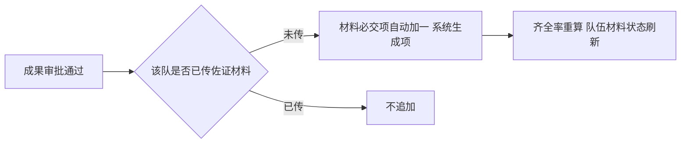

# C 线接口清单——材料管理 + 成果管理

> 作者：ZCode（方案架构师）｜创建时间：2026-10-07 21:50
> 负责人：C（材料成果线）｜错误码段：5xxx
> 状态：待组长与 C 确认后录入 Apifox；**录入后以 Apifox 为准，本文件不再更新**
> 依据：PRD §3.7 材料、§3.8 成果；表：material_task、material_requirement、material_submission、achievement、achievement_file
> 前置依赖：B 线队伍/比赛数据（提交校验）、组长文件服务（/api/files）、组长审批中心（ACHIEVEMENT_SUBMIT）

## 1. 错误码初始表（5xxx）

| code | 含义 |
|------|------|
| 5001 | 文件格式不允许 |
| 5002 | 文件超过大小上限 |
| 5003 | 非本队在队成员，禁止操作 |
| 5004 | 材料要求与赛队所属比赛不匹配 |
| 5005 | 该要求已有提交记录，禁止删除 |
| 5006 | 任务下存在已提交的要求，禁止删除 |
| 5007 | 仅当前队长可上传佐证材料 |
| 5008 | 仅审批通过的成果可导出 |
| 5009 | 无该文件下载权限 |

## 2. 材料任务与要求（/api/materials，管理端配置）

| 编号 | 接口 | 说明 |
|------|------|------|
| MT01 | GET /api/materials/tasks | 任务列表。筛选 contestId；含要求条数、截止时间、状态 |
| MT02 | POST /api/materials/tasks | 创建任务。body：contestId name description deadline |
| MT03 | PUT /api/materials/tasks/{id} | 编辑任务 |
| MT04 | DELETE /api/materials/tasks/{id} | 任务下任一要求有提交记录拒绝（5006） |
| MR01 | POST /api/materials/tasks/{id}/requirements | 添加材料要求。body：materialType（12 种预设枚举）name requiredFlag allowedFormats maxSizeMb namingRule |
| MR02 | PUT /api/materials/requirements/{id} | 编辑要求 |
| MR03 | DELETE /api/materials/requirements/{id} | 已有提交记录拒绝（5005） |

12 种材料类型枚举：REGISTRATION_FORM 报名表、PROJECT_PLAN 项目书、COMMITMENT 承诺书、ID_COPY 身份证复印件、STUDENT_CARD_COPY 学生证复印件、TEAM_PHOTO 团队合照、DEFENSE_PPT 答辩PPT、RESEARCH_REPORT 研究报告、SOURCE_CODE 源代码、AWARD_CERT 获奖证书、EVIDENCE 佐证材料、OTHER 其他。

## 3. 材料提交与查看

| 编号 | 接口 | 说明 |
|------|------|------|
| MS01 | GET /api/materials/teams/{teamId}/overview | 队伍提交概览（管理端或本队成员）：每条要求的状态、当前版本、提交人、提交时间；整体齐全率。管理端另有打点详情视图 |
| MS02 | POST /api/materials/requirements/{requirementId}/submit | 上传单份材料。**队长或队员均可**（PRD §3.7）；校验格式（5001）大小（5002）比赛匹配（5004）；同一要求覆盖上传：旧版本 is_current=0、versionNo+1；**提交后触发齐全率与队伍 material_status 重算**（必交项全齐→SUBMITTED，有缺→PENDING） |
| MS03 | POST /api/materials/requirements/{requirementId}/submit-zip | 压缩包批量上传，按命名规则解析匹配到各要求；命名不匹配的文件跳过并在响应中返回清单（见待确认） |
| MS04 | GET /api/materials/submissions/{submissionId}/download | 下载单个文件。本队成员或管理端（5009）；走鉴权流式下载，不暴露存储地址 |
| MS05 | GET /api/materials/teams/{teamId}/package | 打包下载全队材料（zip 流）；管理端或本队成员 |
| MS06 | GET /api/materials/my | 学生视角：我的队伍材料状态、待补清单、截止提醒 |

## 4. 成果（/api/achievements）

| 编号 | 接口 | 说明 |
|------|------|------|
| A01 | GET /api/achievements | 列表。管理角色全量；普通用户仅自己所在队伍的成果与个人视角。筛选 semesterId teamId type status |
| A02 | GET /api/achievements/{id} | 详情（含佐证文件信息） |
| A03 | POST /api/achievements | 提交成果。队长提交：type name level awardDate description evidenceFileId → PENDING 走 ACHIEVEMENT_SUBMIT 审批；管理员录入：submitChannel=ADMIN 直接生效 |
| A04 | PUT /api/achievements/{id} | 管理员编辑名称/级别/日期/描述 |
| A05 | DELETE /api/achievements/{id} | 管理员删除，级联清理附件关联 |
| A06 | POST /api/achievements/{id}/evidence | 佐证材料上传/覆盖。**仅当前队长**（5007）；单文件覆盖式；不限于奖状，论文、专利、作品均可 |
| A07 | GET /api/achievements/export | 获奖导出。仅本人或管理员；仅导出 APPROVED 成果（5008）；默认 Excel |
| A08 | GET /api/achievements/my/contributions | 个人贡献：参赛记录 + 获奖记录，从赛队成员关系与成果**动态聚合**，不读冗余表 |

## 5. 成果与材料的联动（本线核心规则）

- 联动规则：有审批通过成果但未传佐证的队伍，必交项额外加 1 条"成果佐证材料"（material_requirement.system_generated=1，管理端不可增删）；**待审批状态不提前占用**
- 佐证补传后（A06 或 MS02 命中系统项），齐全率分母不变、分子补齐

## 6. 与其他线/骨架的对接点

- 组长审批中心：A03 队长提交产生 ACHIEVEMENT_SUBMIT；审批通过后进程内回调 C 线 Service（成果置 APPROVED + 触发 §5 联动）
- 组长文件服务：MS02/MS03/A06 上传均先走 /api/files 拿 fileId 再建关联记录
- B 线：MS02 校验"必须在队 + 材料任务属于赛队所在比赛"时读 B 的 team 数据
- A 线：A07 导出按成员聚合时读 member 基础信息

## 7. 待确认事项

- [ ] (需用户确认) MS03 zip 批量上传遇命名不匹配文件的策略：默认**跳过该文件并在响应返回清单**（备选：整包拒绝）
- [ ] (需用户确认) A07 导出格式默认 Excel（xlsx），是否需要追加 PDF
- [ ] (需用户确认) 齐全率百分数保留 2 位小数（DECIMAL 5,2），前端展示取整或保留 1 位
