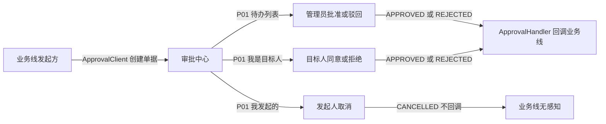
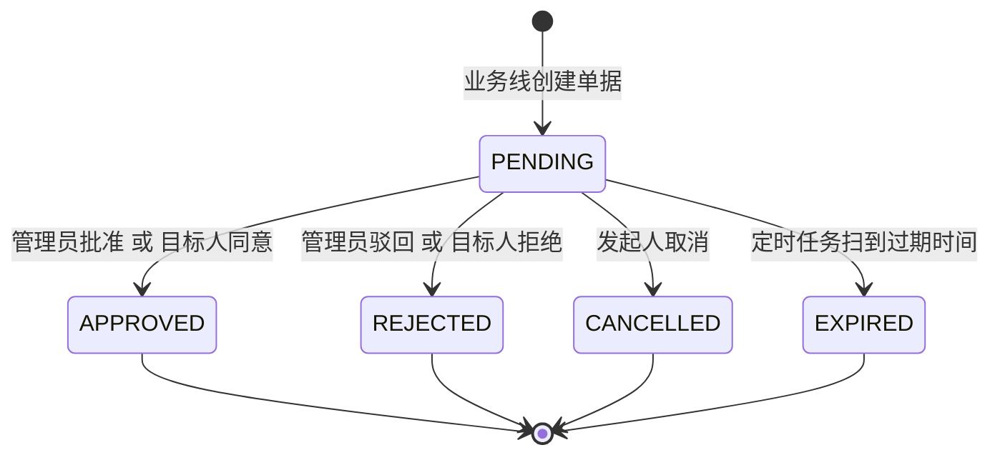

# 审批中心-接口清单

> 作者：ZCode（后端开发）｜创建时间：2026-10-12
> 负责人：组长（骨架域）｜错误码段：6xxx
> 状态：从骨架清单 §6 拆出独立成文，已入库 docs/api（2026-10-12 组长确认）。**九个接口已在 feature/backend-skeleton 实现并测试通过，本文是既成实现的正式化描述**，不是待开发设计；发现本文与代码不一致时以代码为准并回来改文档
> 依据：PRD §3.9 审批中心；表 approval、approval_record；代码 backend/vio-management/.../approval/
> 通用约定（响应体、分页、ID 字符串、时间格式、幂等头）见《全局接口与开发规范》，本文不重复

## 0. 为什么拆这份文档

审批接口原先定义在骨架清单 §6 里，和认证/字典/文件混在一份。拆独立文档三个原因：① Apifox 按域建目录，审批中心需要一份独立可录入的契约；② 后 9 模块（项目查看申请、时间节点审核等）动工前要对接审批，需要独立引用；③ 遗留项（keyword 搜索）需要单独跟踪。骨架清单 §6 后续改为指向本文的索引行（待批准后一起动）。

## 1. 一句话理解审批中心

审批中心是一个**通用单据引擎**：各业务线把"需要人拍板的事"写成一张审批单塞进来（进程内调 ApprovalClient），管理员或目标人在中心里处理，处理完审批中心按单据类型回调对应业务线（ApprovalHandler）去落地正式数据。审批中心自己不懂任何业务，只管单子的状态、权限和流水。



## 2. 错误码表（6xxx，归组长维护）

| code | 含义 |
|------|------|
| 6001 | 审批单不存在或已处理（两个管理员并发批同一张单，后到者也返回此码） |
| 6002 | 无权处理该审批 |
| 6003 | 当前审批状态不允许该操作（只有 PENDING 可处理） |

另用通用码：view 传值不合法返回 1001；学生调管理员接口返回 1003。

## 3. 状态机与关键机制



- **一跳终结**：单子只有 PENDING 一个活动态，管理员批准和目标人同意任一方先操作就终结（都转 APPROVED），没有"管理员批完再等队员确认"的中间态。
- **两段式业务怎么表达**：需要"管理员批完、队员再确认"的业务（如 B 线加人），在 onApproved 回调里把业务数据置为"未确认"，队员的确认/拒绝走该业务线**自己的接口**，不再回审批中心开第二张单。
- **并发防重**：状态更新用"WHERE status='PENDING'"条件更新，两个管理员同时批同一张单，后到的更新 0 行按 6001 拒绝——审批结果与回调绝无二次执行。
- **过期**：有效期 `vio.approval.expire-days`（默认 7 天）；定时任务每 60 秒扫一次 expire_at 转 EXPIRED，不提供 HTTP 过期接口。
- **流水**：每个动作（发起/取消/批准/驳回/同意/拒绝/过期）写一条 approval_record，含动作、操作人、身份、意见、前后状态、IP、时间。

## 4. 接口明细（/api/approvals）

**三视角**（P01 的 view 参数）：TODO 管理员待办 / MINE 我发起的 / TARGET 我是目标人。

**数据范围**：超管看全部；部门管理员 TODO 视角按审批责任组织子树过滤；学生只能用 MINE / TARGET 看自己的。

| 编号 | 接口 | 说明 |
|------|------|------|
| P01 | GET /api/approvals | 参数 view（必填，TODO/MINE/TARGET）status bizType keyword page size。keyword 为标题模糊搜索（2026-10-12 拍板补上，代码已实现）。学生调 TODO 返回 1003。按创建时间倒序。列表项字段见下方 ApprovalVO |
| P02 | POST /api/approvals/{id}/approve | 管理员批准，body：comment。仅 SUPER_ADMIN / DEPT_ADMIN（注解拦截），部门管理员须审批责任组织在其子树内否则 6002。事务内按 bizType 路由回调。带幂等头与审计 |
| P03 | POST /api/approvals/{id}/reject | 管理员驳回，body：comment。回调 onRejected（各线通常无动作） |
| P04 | POST /api/approvals/{id}/cancel | 发起人取消，body：comment。仅申请人本人（按人员档案 ID 判断，学生可操作自己的单）。**取消不触发业务回调** |
| P05 | POST /api/approvals/{id}/agree | 目标人同意（如被邀请的队员），body：comment。单据转 APPROVED 并触发 onApproved |
| P06 | POST /api/approvals/{id}/refuse | 目标人拒绝，body：comment。单据转 REJECTED |
| P07 | PUT /api/approvals/read | 已读标记。body：ids 数组 + asRole（APPLICANT/TARGET/APPROVER），只置当前视角对应的已读位 |
| P08 | GET /api/approvals/unread-count | 两类红点数：todoCount（发给我的邀请/通知，PENDING 且未读）+ resultCount（我发起的已出结果且未读）。未绑定人员档案的纯管理账号返回两个 0 |
| P09 | GET /api/approvals/{id} | 详情 = 列表字段 + bizPayload 申请快照 + records 操作流水（时间正序）。可见性：超管 / 发起人 / 目标人 / 审批组织子树内管理员，其余 6002 |

P02–P06 均要求 X-Idempotency-Key 幂等头，且均写审计日志。

**ApprovalVO 列表项**：id bizType bizTitle status applicantName targetMemberName applyReason handleComment handledAt createdAt。
**ApprovalDetailVO** 在列表项基础上加：bizPayload（JSON 字符串，各业务线快照结构由各线在自己的清单里登记）+ records[]（action operatorName operatorRole commentText createdAt）。
**UnreadCountVO**：todoCount resultCount。

## 5. 业务线对接契约（进程内，非 HTTP）

**创建单据 ApprovalClient.createApproval(ApprovalCreateDTO) → approvalId**，各业务线注入直接调，不走 HTTP：

| 字段 | 说明 |
|------|------|
| bizType | 业务类型，§6 词表内取值 |
| bizId | 更新型审批填既有业务对象 ID；创建型填 null |
| bizTitle | 列表展示标题（如"队名 + 比赛名"） |
| payloadJson | 申请内容快照 JSON（详情页展示 + 回调时业务线解析） |
| applicantMemberId / applicantName | 发起人（人员档案 ID + 姓名冗余） |
| targetMemberId / targetMemberName | 目标人，可空（无目标人的申请型单据不填） |
| approverOrgId | 审批责任组织 ID，决定哪个部门管理员收到待办 |
| applyReason / teamId / contestId / semesterId | 申请说明与业务关联冗余，可空 |

**回调 SPI ApprovalHandler**（实现后注册为 Spring Bean，按 bizType 路由）：

```java
String bizType();                                                    // 负责的业务类型
Long onApproved(Long approvalId, Long bizId, String payloadJson);    // 批准/同意后回调，返回新建业务 ID（更新型返回 null）
void onRejected(Long approvalId, Long bizId, String payloadJson);    // 驳回/拒绝后回调，通常留空
```

实现方契约四条（2026-10-09 组长评审定稿）：
1. **至多一次**：骨架用条件更新保证同一单子回调只执行一次且回调与审批处理同事务——事务内纯数据库操作**无需**自建幂等。
2. **事务外副作用**（调外部系统、发消息、写对象存储）不受回滚保护，失败重试可能重放，须实现方按 approvalId 自行设防。
3. **bizId 口径**：更新型审批 = 既有对象 ID；创建型提交时为 null，onApproved 返回新建对象 ID 由骨架回填 approval.biz_id（单据可追溯）。
4. **兜底**：骨架提供 FallbackApprovalHandler，未注册的业务类型只记日志不动作，不会静默丢失。

## 6. bizType 词表（与表结构注释一致）

| bizType | 用途 | 归属线 | 状态 |
|---------|------|--------|------|
| TEAM_CREATE | 创建赛队 | B 线 | **退役 2026-10-24**（队长直建拍板，存量历史单仅展示） |
| TEAM_ADD_MEMBER | 添加队员 | B 线 | 在用（队长发起 + 目标人同意即终结） |
| TEAM_REMOVE_MEMBER | 移除队员 | B 线 | **退役 2026-10-24**（拍板A 队长直移，存量历史单仅展示） |
| TEAM_ADD_ADVISOR | 添加指导教师 | B 线 | 在用（队长发起 + 目标人同意即终结） |
| TEAM_DISSOLVE | 解散赛队 | B 线 | 未启用（解散实为 TE12 直删不走审批） |
| ACHIEVEMENT_SUBMIT | 成果提交 | C 线 | 在用 |
| PROJECT_VIEW | 项目查看申请（本部门用户查看他人项目） | 项目管理线 | 在用（2026-10-24 拍板保持管理员审批） |
| MILESTONE_APPROVE | 比赛时间节点审核 | 项目管理线 | 在用 |
| SEMESTER_SWITCH | 学期切换 | A 线 | 在用 |

管理员审批中心实际可见类型：成果提交、项目查看、节点审核、学期切换（前端按 APPROVAL_CAPTAIN_TYPES 过滤队伍自治类）。

新增 bizType 流程：各线在自己清单里登记 → 到本文此表汇总。**不登记直接用只会落到兜底 Handler（记日志不动作）**，不会报错但业务不生效。

## 7. 已知遗留

- ~~P01 无 keyword 搜索~~ **已于 2026-10-12 补上**（DTO 加参数 + 查询加模糊匹配 + 测试覆盖，11 条审批测试全绿）
- bizPayload 是 JSON 字符串，各线快照结构尚未在任何文档集中登记（各线清单补）
- 审批中心无"我的申请被处理"的主动推送，红点靠前端轮询 P08

## 8. 待确认事项

- [x] (2026-10-12 组长确认) 已移入 docs/api；骨架清单 §6 已加索引指针
- [ ] (需用户确认) 录入 Apifox（Apifox 建项目后统一做）
- [ ] (需用户确认) 遗留项 keyword 搜索是否本期补（P01 加 keyword 参数模糊匹配 biz_title，改动很小）
- [ ] (需用户确认) PROJECT_VIEW / MILESTONE_APPROVE 两个 bizType 的触发场景细节，待项目管理清单（本系列下一篇）定稿后在 §6 补用途描述
