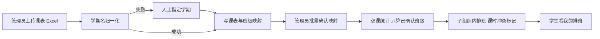
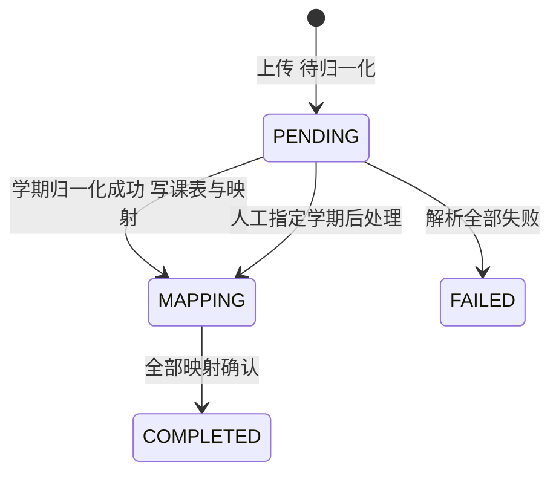
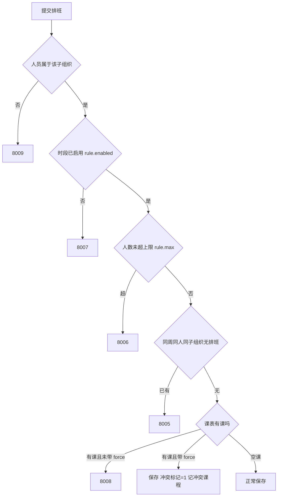

# 排班管理-接口清单

> 作者：ZCode（后端开发）｜创建时间：2026-10-12
> 负责人：排班管理线（后 9 模块之一，具体人选待组长定）｜错误码段：8xxx（与绩效共用：**8001–8039 排班，8040 起绩效**）
> 状态：已入库 docs/api（2026-10-12 组长确认）。待录入 Apifox；录入后以 Apifox 为准
> 依据：PRD §3.11 排班管理；表：timetable_import、course_timetable、class_mapping、schedule、schedule_rule（5 张，表结构即契约）
> 前置依赖：骨架认证与数据范围（已交付）、A 线 semester 教学周数与 member 班级数据、骨架文件服务（课表文件存储）
> 通用约定见《全局接口与开发规范》，本文不重复

## 0. 一句话理解排班管理

排班的前提是知道**谁什么时候没课**。所以流程分三步：①管理员把学校课表 Excel 导进来（系统把"课表班级名"和"档案班级名"对上号）；②系统算出每个时段谁空课（仅管理员可查）；③管理员在子组织内按"学期+周次+子组织"给空课的人排值班。学生只看自己的班次。

## 1. 错误码表（8xxx 排班段 8001–8039）

| code | 含义 |
|------|------|
| 8001 | 课表文件解析失败（message 带行号与原因） |
| 8002 | 学期名称归一化失败，请人工指定学期 |
| 8003 | 导入批次当前状态不允许该操作 |
| 8004 | 班级映射不存在 |
| 8005 | 该周次该人在该子组织已有排班 |
| 8006 | 该时段排班人数已达上限 |
| 8007 | 该时段未启用排班 |
| 8008 | 排班与课表冲突，确认强制保存请带 force |
| 8009 | 排班人员不属于该子组织 |
| 8010 | 周次超出学期教学周数 |

## 2. 课表导入（/api/timetables，仅管理员）

导入批次状态机：

| 编号 | 接口 | 说明 |
|------|------|------|
| TT01 | GET /api/timetables/import-template | 模板下载（16 列 + 5 条示例行，格式对齐学校导出）。走骨架文件服务存储，鉴权下载 |
| TT02 | POST /api/timetables/imports | 上传导入。multipart：file。创建批次并同步解析：学期名归一化（失败批次留 PENDING 等 TT05）→ 课表行写 course_timetable → 班级去重写 class_mapping（confirmed=0）→ 转 MAPPING。返回批次 ID 与成功失败数。带幂等头 |
| TT03 | GET /api/timetables/imports | 批次列表：状态、学期、总数、成功失败数、导入时间。按学期筛选 |
| TT04 | GET /api/timetables/imports/{id} | 批次详情含每行错误明细 |
| TT05 | PUT /api/timetables/imports/{id}/semester | 归一化失败时人工指定学期。仅 PENDING 且未关联学期可用（8003），指定后立即续跑解析 |
| TT06 | GET /api/timetables/class-mappings | 映射列表：classKey 课表班级原始名 档案侧班级名 年级 年级来源 确认状态。按学期筛选、按确认状态筛选 |
| TT07 | PUT /api/timetables/class-mappings/confirm | 批量确认映射。body：ids 数组。确认后该班级参与空课统计；**未确认的班级永远不参与空课统计**（PRD 铁规则） |
| TT08 | GET /api/timetables/courses | 课表记录查询（管理端核对）：semesterId weekNo classKey 筛选，含课程名 教师 地点 单双周 |

## 3. 空课查询（/api/schedules/free-slots，仅超管与部门管理员——PRD 明确）

空课判定规则：某班级在 (weekNo, weekday, slotIndex) 无课记录即该格空课；**单双周要算**（ODD 单周课只在奇数周占用、EVEN 双周课只在偶数周占用）；同格多门课取并集（任一门有课即非空课）。名单只含已确认映射班级的成员。

| 编号 | 接口 | 说明 |
|------|------|------|
| SC06 | GET /api/schedules/free-slots/matrix | 整周 7×5 概览矩阵。参数：semesterId weekNo。每格返回 freeCount 与按年级的人数分布。前端画格子用 |
| SC07 | GET /api/schedules/free-slots | 单格空课名单。参数：semesterId weekNo weekday slotIndex。按年级分组（学号推导优先、班级名兜底，取自 class_mapping.grade 与 grade_source），含姓名与班级 |

## 4. 子组织排班（/api/schedules）

排班校验链（SC02/SC03 共用，按序拦截）：

| 编号 | 接口 | 说明 |
|------|------|------|
| SC01 | GET /api/schedules | 周排班表。参数：semesterId weekNo subOrgId。7×5 格子视图，每格含排班人员（姓名、班级、值班内容、冲突标记）。超管全部、部门管理员本子树 |
| SC02 | POST /api/schedules | 批量排班。body：semesterId weekNo subOrgId assignments 数组（memberId weekday slotIndex dutyName）force。过 §4 校验链；冲突课保存 course_conflict=1 与 conflict_note。带幂等头与审计 |
| SC03 | PUT /api/schedules/{id} | 编辑单条（改时段、值班内容、备注），重新过校验链 |
| SC04 | DELETE /api/schedules/{id} | 取消排班（置 CANCELLED）。带审计 |
| SC05 | GET /api/schedules/my | **我的排班（学生视角，管理端隐藏此菜单）**。参数 semesterId weekNo（均可选）。返回：周次、子组织名、星期、节次、值班内容、备注 |

## 5. 排班规则（/api/schedules/rules，子组织维度的时段配置）

规则匹配：优先取"子组织+学期"的特定规则，无则回退该子组织的默认规则（semester_id 为空）。未配置的时段视为不启用（8007）。

| 编号 | 接口 | 说明 |
|------|------|------|
| SC10 | GET /api/schedules/rules | 规则列表。参数：subOrgId semesterId（可空看默认）。含每时段 enabled minPerson maxPerson |
| SC11 | PUT /api/schedules/rules | 批量保存（upsert）。body：subOrgId semesterId（可空=默认规则）items 数组（weekday slotIndex minPerson maxPerson enabled）。仅管理员 |

## 6. 导出（Excel）

| 编号 | 接口 | 说明 |
|------|------|------|
| SC08 | GET /api/schedules/export | 周排班表导出。参数：semesterId weekNo subOrgId。zip 流或 xlsx 流，管理员 |
| SC09 | GET /api/schedules/export-stats | 学期排班统计导出。参数：semesterId subOrgId。每人排班次数与明细汇总，管理员 |

## 7. 与骨架和其他线的对接点

- 骨架文件服务：TT01 模板与 TT02 上传的课表文件走 /api/files
- A 线：TT02 学期归一化读 semester（A 线 S02 含教学周数）；空课名单读 member 班级；SC02 校验 weekNo 不超教学周数（8010）
- 绩效线：排班数据（schedule）可作为绩效统计的出勤参考（见绩效清单）
- AI 助手（§3.15）：可查询"空课信息（仅管理角色）与我的排班"——AI 工具调用走本模块 SC05/SC06/SC07 同源逻辑，权限随当前用户
- 概览统计：无新增（拍板口径：前端调各线列表 total）

## 8. 拍板记录与待确认事项

> 2026-10-12 组长拍板：
> ① **同周同人同子组织仅一条有效排班**（PRD 字面）——schedule 表唯一键不动（现键含节次不含星期，
>   与该规则不完全对齐，由 service 层校验 8005 兜底；改表需另走契约变更流程）
> ② 课表导入采用**同步解析**（学校课表量小够用），实测卡顿再改异步轮询 TT04
> ③ SC02 的 force 强制保存确认弹窗归前端体验，后端只认 force 参数

- [x] (2026-10-12 组长确认) 已移入 docs/api
- [ ] (需用户确认) 录入 Apifox 排班目录
