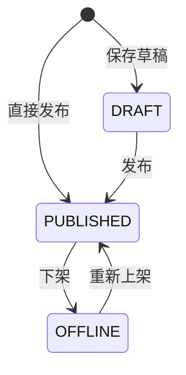

# 知识库接口清单

> 作者：ZCode（方案架构师）｜创建时间：2026-10-13 15:40
> 负责人：后 9 模块 3 人分摊（CRUD 线）；检索增强与 RAG 预留层归组长 ｜ 错误码段：9xxx（9001 起，AI 助手后续从 9xxx 续段）
> 状态：待组长与负责人确认后录入 Apifox；**录入后以 Apifox 为准，本文件不再更新**
> 依据：PRD §3.14 知识库；表：kb_doc、kb_comment、kb_collect
> 定位拍板（2026-10-13 组长）：**后端归管理系统**（数据范围/文件服务/审计三依赖）；**页面入口在论坛前端壳**（阶段三，经 Nginx 网关调 /api/kb，网关按路径转发）；内容来源=管理员上传/外部链接/AI 总结，无推送弹窗，"推荐位"用 KB03 卡片承载

## 1. 错误码初始表（9xxx）

| code | 含义 |
|------|------|
| 9001 | 重复收藏该文档（uk_kb_collect 唯一键拦截） |
| 9002 | 文档不存在或已下架 |

其余复用 1xxx：参数 1001 / 权限 1003 / 不存在 1004 / 状态不允许 1006。

## 2. 浏览侧（登录即可）

| 编号 | 接口 | 说明 |
|------|------|------|
| KB01 | GET /api/kb/docs | 列表。筛选 category keyword sourceType；仅 PUBLISHED；置顶优先再时间倒序。keyword 走 FULLTEXT ngram（title+summary，索引建表已有） |
| KB02 | GET /api/kb/docs/{id} | 详情：正文 Markdown + 附件信息 + 当前用户是否已收藏；浏览数 +1（同步 UPDATE，量小）；非 PUBLISHED → 9002 |
| KB03 | GET /api/kb/docs/recommend | 推荐位：置顶 + 最新 N 条（默认 5 上限 10），首页/论坛页卡片 |
| KB04 | GET /api/kb/prompts | AI 提示词列表（is_prompt=1 且 PUBLISHED）：title summary promptSchema——聊天界面一键复用的数据源 |

## 3. 收藏（登录即可）

| 编号 | 接口 | 说明 |
|------|------|------|
| KB05 | POST /api/kb/docs/{id}/collect | 收藏，幂等键；重复 → 9001；collect_count +1 同事务 |
| KB06 | DELETE /api/kb/docs/{id}/collect | 取消收藏，collect_count −1 |
| KB07 | GET /api/kb/my/collections | 我的收藏列表（时间倒序，带文档摘要） |

## 4. 评论（登录即可，即时显示不审核）

| 编号 | 接口 | 说明 |
|------|------|------|
| KB08 | GET /api/kb/docs/{id}/comments | 评论列表分页（时间正序），含楼中楼（parent_id 折叠展示） |
| KB09 | POST /api/kb/docs/{id}/comments | 发表/回复。body：content parentId（可空）；comment_count +1；幂等键 |
| KB10 | DELETE /api/kb/comments/{id} | 删除：本人或管理员；comment_count −1 |
| KB11 | PUT /api/kb/comments/{id}/hide | 管理员隐藏/恢复（status VISIBLE↔HIDDEN）；计数随可见口径 ±1 |

## 5. 管理侧（管理员 + 数据范围）

| 编号 | 接口 | 说明 |
|------|------|------|
| KB12 | POST /api/kb/docs | 发布/存草稿。body：title category isPrompt promptSchema content summary coverFileId attachFileId sourceType sourceUrl tags status orgId。校验：LINK 必填 sourceUrl；isPrompt=1 必填 promptSchema；幂等键 |
| KB13 | PUT /api/kb/docs/{id} | 编辑全字段（LINK 类型只改链接与简介） |
| KB14 | DELETE /api/kb/docs/{id} | 逻辑删除；评论收藏不级联清（随文档整体不可见） |
| KB15 | PUT /api/kb/docs/{id}/top | 置顶 / 取消置顶 |
| KB16 | PUT /api/kb/docs/{id}/status | 上架 PUBLISHED ↔ 下架 OFFLINE |
| KB17 | GET /api/kb/admin/docs | 管理视角列表（含 DRAFT/OFFLINE）。筛选 status category keyword |

## 6. 计数与联动口径

- view_count：详情页同步 +1（100–200 人规模直更库；阶段 3 再议 Redis 计数）
- collect_count / comment_count：增删同事务 ±1，口径 = 可见数
- 收藏防重靠表上唯一键 uk_kb_collect(doc_id, member_id)，撞键返回 9001 不回放

## 7. 检索增强与 RAG 预留（组长，阶段 3，本清单不定义）

- 本期检索：KB01 keyword 用 MySQL FULLTEXT ngram（够用）
- 阶段 3 RAG 落点：文档切片 + embedding + 向量/混合检索 + 召回喂 GLM，届时评估 ES 或向量库
- 论坛精华帖归档为文档（版主推荐，架构方案预设）：阶段 2/3 对接，source_type 届时扩展，不预设

## 8. 与骨架/其他线对接点

- 文件服务：封面/附件先走 /api/files 拿 fileId（ClamAV 查毒链路顺带覆盖）
- 字典：category 走 KB_CATEGORY（系统配置清单 DR01）
- 审计：管理写操作挂 @AuditLog（bizType=KB），AQ01 可筛
- 前端入口：论坛前端壳（阶段三）经网关调 /api/kb/*——页面在论坛、服务在管理系统，不矛盾

## 9. 待确认事项

- [ ] (需用户确认) 学生可见性：默认全部 PUBLISHED 全员可见（不按组织隔离），org_id 仅作管理端归属标记
- [ ] (需用户确认) 部门管理员管理范围 = 本子树文档；org_id 为空的全局文档仅超管可管
- [ ] (需用户确认) 评论即时显示不审核，违规靠管理员隐藏/删除
- [ ] (需用户确认) 检索本期用 MySQL ngram，阶段 3 是否升级 ES/向量随 RAG 一并定
