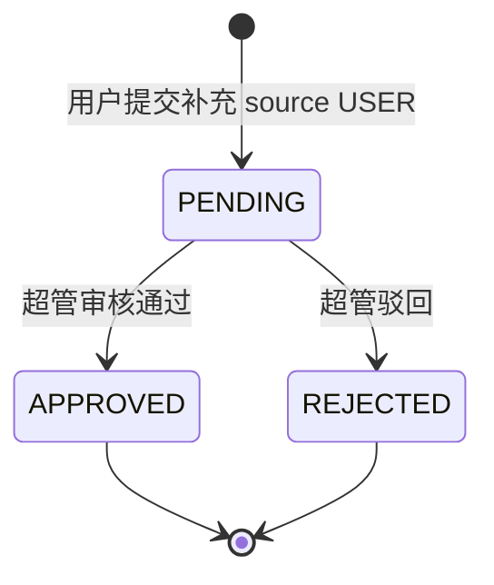

# 系统配置接口清单——字典管理 + 系统参数

> 作者：ZCode（方案架构师）｜创建时间：2026-10-13 14:30
> 负责人：组长（骨架）｜错误码段：**不设专段，复用 1xxx 通用码**（同审计查询先例）
> 状态：待组长确认后录入 Apifox；**录入后以 Apifox 为准，本文件不再更新**
> 依据：PRD §2.1 超管独占"系统配置"、§3.1 技能标签字典与用户补充审核；表：sys_dict_type、sys_dict_item、sys_config
> 前置：DR01 已由骨架实现（DictController），其余为本清单新增，均在骨架侧补齐

## 1. 边界与权限

- **菜单归属**：系统配置是超管独占菜单（PRD §2.1/§2.3），部门管理员端隐藏
- **DR01 字典读**例外：登录即可调（前端所有枚举下拉统一走它，无角色门槛）
- 写操作全部挂 `@AuditLog`（超管动作可在审计中心 AQ01 查）；创建/审核类带 `X-Idempotency-Key`（规范 §6）
- 通用错误映射：非超管 → 1003；参数/重复 → 1001；不存在 → 1004；状态不允许 → 1006

## 2. 字典读取（已有接口，全角色）

| 编号 | 接口 | 说明 |
|------|------|------|
| DR01 | GET /api/dicts/{code} | 按编码取条目（启用 + 审核通过的 PRESET/USER 项），前端枚举下拉统一入口。**已实现** |

预设字典类型（建库种子，不可删）：SKILL 技能标签（PRD §3.1）、MATERIAL_TYPE 材料类型（C 线 12 种）、KB_CATEGORY 知识库分类（PRD §3.14）。

## 3. 字典类型管理（超管）

| 编号 | 接口 | 说明 |
|------|------|------|
| SY01 | GET /api/dicts | 类型列表：dictCode dictName remark 条目数 待审核数 |
| SY02 | POST /api/dicts | 创建类型。body：dictCode dictName remark；编码重复 → 1001 |
| SY03 | PUT /api/dicts/types/{id} | 编辑名称/说明（dictCode 创建后不可改） |
| SY04 | DELETE /api/dicts/types/{id} | 删除：预设类型或仍有条目 → 1006（先清空条目再删自定义类型） |

## 4. 字典条目管理（超管）

| 编号 | 接口 | 说明 |
|------|------|------|
| SY05 | GET /api/dicts/{code}/items | 管理视角条目列表（含停用/待审核项）。筛选：source status auditStatus keyword |
| SY06 | POST /api/dicts/{code}/items | 新增条目（source=PRESET，直接 APPROVED）。body：itemValue itemLabel sortNo；value 重复 → 1001 |
| SY07 | PUT /api/dicts/items/{id} | 编辑 label / 排序 |
| SY08 | DELETE /api/dicts/items/{id} | 逻辑删除。默认不做业务引用强校验（value 原文兜底展示），**停用优先于删除** |
| SY09 | PUT /api/dicts/items/{id}/status | 启用 / 停用。停用项不再出现在 DR01，历史数据不受影响 |

## 5. 用户补充词条与审核（PRD §3.1 技能标签）

| 编号 | 接口 | 说明 |
|------|------|------|
| SY10 | PUT /api/dicts/items/{id}/audit | 审核用户补充词条。body：auditStatus（APPROVED/REJECTED）+ comment；非 USER/PENDING 状态 → 1006 |
| SY11 | POST /api/dicts/skill-items | 用户补充技能词条（登录即可）。body：itemValue itemLabel；落库 source=USER + PENDING；与现有 value 重复 → 1001 |

## 6. 系统参数（超管，sys_config）

| 编号 | 接口 | 说明 |
|------|------|------|
| CF01 | GET /api/configs | 参数列表：configKey configValue configName editable remark |
| CF02 | PUT /api/configs/{key} | 修改参数值。editable=0 → 1006；key 不存在 → 1004。参数由建库种子维护，**不提供新增/删除** |

## 7. 与骨架/其他线对接点

- DR01 消费方：C 线材料 12 类型（MS01/MS02）、知识库分类（PRD §3.14）、成员技能标签（A 线 §3.1）
- 审计中心：全部写操作走 `@AuditLog`，AQ01 按 bizType=DICT/CONFIG 可筛
- Redis 伏笔：字典低频写、高频读，是审批中心 Redis 引入后的**第一个缓存候选**（Cache Aside，改字典删缓存）
- 规范 §3.1 责任田表需补两行：`/api/dicts`、`/api/configs` 归组长（骨架）——本清单入库时顺手改

## 8. 待确认事项

- [ ] (需用户确认) SY08 条目删除不做引用强校验、以停用代替——业务侧 value 对不上 label 时原文兜底，是否够用
- [ ] (需用户确认) SY11 用户补充词条仅开放 SKILL 字典（MATERIAL_TYPE/KB_CATEGORY 仍超管维护）
- [ ] (需用户确认) 初始参数清单（sys_config 种子键值对）由组长列出后再入库
