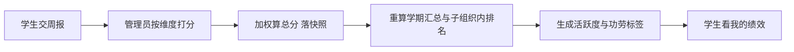
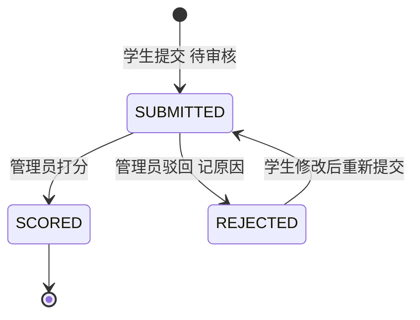

# 绩效统计-接口清单

> 作者：ZCode（后端开发）｜创建时间：2026-10-12
> 负责人：绩效统计线（后 9 模块之一，具体人选待组长定）｜错误码段：8xxx 绩效段 **8040 起**（8001–8039 归排班，见排班清单 §1）
> 状态：已入库 docs/api（2026-10-12 组长确认）。待录入 Apifox；录入后以 Apifox 为准
> 依据：PRD §3.13 绩效统计；表：performance_rule、performance_weekly、performance_score、performance_summary（4 张，表结构即契约）
> 前置依赖：骨架认证与数据范围（已交付）、骨架文件服务 /api/files（周报附件）、A 线 semester 教学周数与 member 数据
> 通用约定见《全局接口与开发规范》，本文不重复

## 0. 一句话理解绩效统计

学生每周交一份"本周干了啥"（文字+可选附件）→ 管理员按**本子组织的打分维度**逐项打分（每个子组织维度和权重不一样，数媒协会和数媒二楼各一套）→ 系统加权算总分、自动累计到学期汇总并排名 → 挂上"活跃度上升""功劳度高"这类标签。**绩效打分不走审批中心**——PRD 明确管理员直审，打分动作本身就是审核。

## 1. 错误码表（8xxx 绩效段 8040 起）

| code | 含义 |
|------|------|
| 8040 | 周报不存在 |
| 8041 | 该周该子组织已提交过周报 |
| 8042 | 周报当前状态不允许该操作 |
| 8043 | 打分维度与该子组织规则不符 |
| 8044 | 维度得分超过满分 |
| 8045 | 仅本人可操作自己的周报 |
| 8046 | 该子组织未配置绩效规则，请先配置 |
| 8047 | 周次超出学期教学周数 |

## 2. 周报状态机

同人同周同子组织仅一份周报（表唯一键保证）；驳回不删记录，改内容后原记录重新进待审核。

## 3. 接口明细

### 3.1 学生侧（/api/performance/my）

| 编号 | 接口 | 说明 |
|------|------|------|
| PF01 | GET /api/performance/my/weeklies | 我的周报列表。筛选：semesterId（默认当前学期）status。列表项：weekNo subOrgName status totalScore submittedAt |
| PF02 | POST /api/performance/weeklies | 提交周报。body：weekNo workContent attachFileId（可选，走骨架 F01 先拿 fileId）。subOrgId 服务端取本人所属组织。同周已有 SUBMITTED 或 SCORED 拒绝（8041）；REJECTED 走 PF03。带幂等头 |
| PF03 | PUT /api/performance/weeklies/{id} | 重新提交。仅本人（8045）且 REJECTED 状态（8042），改内容后回 SUBMITTED |
| PF04 | GET /api/performance/weeklies/{id} | 周报详情：工作内容、附件、状态、总分；SCORED 后含各维度得分明细与评语 |
| PF05 | GET /api/performance/my/summary | 我的绩效汇总（当前学期）：总分、平均分、最高周、子组织内排名、近 4 周趋势、活跃度标签 |

### 3.2 管理侧（/api/performance，部门管理员本子树、超管全部）

| 编号 | 接口 | 说明 |
|------|------|------|
| PF06 | GET /api/performance/weeklies | 周报列表（审核工作台）。筛选：semesterId weekNo subOrgId status memberKeyword。列表项：memberName subOrgName weekNo status totalScore submittedAt |
| PF07 | POST /api/performance/weeklies/{id}/score | **打分**。body：scores 数组（dimensionKey score commentText）+ scoreComment 总评。校验：维度集合须与该子组织 enabled 规则完全一致（8043）、各维度不超满分（8044）、未配置规则拒绝（8046）。落库时**快照**当时的 weight 与 max_score（规则后续变更不影响历史分）；算 weighted_score 与加权总分；当周标签生成；事务内重算 summary 与子组织内排名。带幂等头与审计 |
| PF08 | POST /api/performance/weeklies/{id}/reject | 驳回。body：reason（必填）。置 REJECTED；带审计 |
| PF09 | GET /api/performance/summaries | 汇总列表（评优参考）。筛选：semesterId subOrgId memberKeyword。按 total_score 降序，含排名、平均分、标签 |
| PF10 | GET /api/performance/export | 导出 Excel。参数：semesterId subOrgId groupBy（MEMBER 按人聚合 / ORG 按子组织聚合）。管理员 |

### 3.3 打分规则配置（/api/performance/rules，管理员）

规则匹配：优先"子组织+学期"特定规则，无则回退子组织默认（semester_id 为空）。**子组织未配置任何规则时该组织无法打分**（8046），实施顺序上规则先行。

| 编号 | 接口 | 说明 |
|------|------|------|
| PF11 | GET /api/performance/rules | 规则列表。参数：subOrgId semesterId（可空看默认）。含 dimensionKey dimensionName weight maxScore enabled sortNo |
| PF12 | PUT /api/performance/rules | 批量保存（upsert）。body：subOrgId semesterId（可空=默认）items 数组。维度键建议用大写蛇形（如 TECH_OUTPUT 技术产出、COLLABORATION 协作贡献、ATTENDANCE 出勤） |

## 4. 计分与标签规则（内置实现，文案可调）

- **加权总分** = Σ（各维度得分 × 当时权重快照），保留 2 位小数
- **汇总重算**：PF07 打分事务内同步重算该成员该学期的 summary（提交数、打分数、总分、平均分、最高周、近 4 周趋势斜率）并重排子组织内名次
- **内置标签**（打分后自动挂，activity_tags JSON）：

| 标签 | 触发条件 |
|------|---------|
| 活跃度上升 | 近 4 周分数趋势斜率 > 0 |
| 活跃度下降 | 近 4 周分数趋势斜率 < 0 |
| 功劳度高 | 子组织内排名前 20% |
| 连续贡献 | 连续提交且打分 ≥ 4 周 |
| 高效周 | 单周加权总分 ≥ 满分的 90% |

- 排班线联动（可选参考）：ATTENDANCE 类维度打分时管理员可对照排班记录人工参考，**不自动取数**（PRD 未要求自动联动，避免规则复杂化）

## 5. 与骨架和其他线的对接点

- 骨架文件服务：周报附件走 F01 上传拿 fileId，下载走 F02（附件无隐私分级，本表不单独出下载接口）
- A 线：semester 教学周数校验（8047）、member 姓名与组织数据
- 排班线：出勤类维度的人工参考数据源（SC01 周排班表）
- AI 助手（§3.15）：可查询"本周绩效"——走 PF05 同源逻辑，权限随当前用户
- 概览统计：学生端"本周绩效"卡片 = PF05 数据；部门管理员"本部门绩效"= PF09 的 total。无新增统计接口（拍板口径）
- **不走审批中心**：绩效审核是管理员直审动作（PRD §3.13），审批词表无绩效类型，此处显式说明防误解

## 6. 待确认事项

- [ ] (需用户确认) §4 内置标签的触发阈值（前 20%、连续 4 周、90% 满分）与文案，可实施时调整
- [ ] (需用户确认) PF10 导出默认 Excel（xlsx），是否需要追加 PDF
- [x] (2026-10-12 组长确认) 已移入 docs/api
- [ ] (需用户确认) 录入 Apifox 绩效目录
