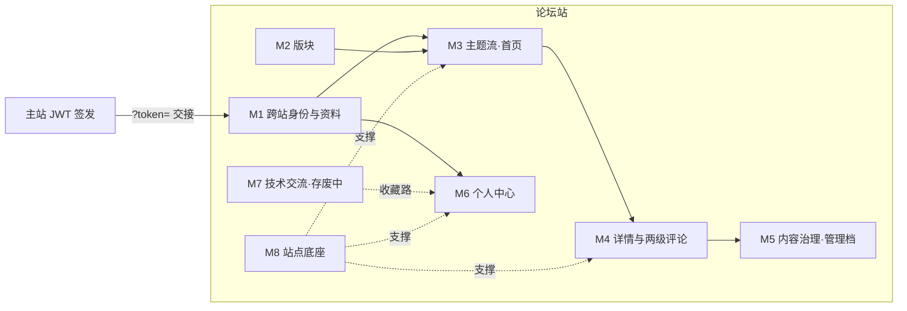

# 论坛需求梳理（按功能模块）

> 2026-10-23 · 论坛线（lzh 全权）· 配套文档：《论坛-需求梳理-前端驱动.md》= 接口契约视角，本文 = **功能模块 / 产品视角**
> 范围：论坛站 `forum/`（5175）+ `vio-forum`（8089）+ `vioforum` 库（8 业务表）。
> 边界约定：登录态与账号权限由主站确定，是唯一跨站依赖；其余全部论坛域内自治。

---

## 一、模块地图

| 模块 | 一句话 | 用户可见入口 |
|------|--------|--------------|
| M1 | 跨站登录、身份资料、头像 | 门页 / 顶栏头像 |
| M2 | 版块（分类容器） | 首页频道行 |
| M3 | 主题列表、搜索、标签、热议、统计、发帖 | 首页 |
| M4 | 帖子详情、两级评论、点赞收藏 | 详情页 |
| M5 | 管理档：编辑/隐藏/恢复/置顶、含隐藏视图 | 列表与详情的管理入口 |
| M6 | 我的主题/回复/收藏/点赞/订阅 | 个人中心 |
| M7 | 技术推送内容流 | 顶栏"技术交流" |
| M8 | 双主题、部署、审计落账、幂等 | 底座（不可见） |

## 二、模块 × 接口映射总表

✅ 已实现并实测（2026-10-23）· ❌ 缺失 · ⚠️ 待拍板

| 模块 | 已实现 | 缺失/待定 |
|------|--------|-----------|
| M1 身份 | 主站 auth/my-profile（跨站依赖） | 生产交接机制（P0）、头像上传（P4） |
| M2 版块 | B01 下发 ✅ | 前端未接（硬编码，P3）；版块管理接口无需求暂不做 |
| M3 主题流 | F01 列表 ✅ F02 热议 ✅ F03 统计 ✅ F06 发帖 ✅ | 标签行量大后的聚合接口（观察） |
| M4 详情评论 | F04 ✅ F05 ✅ F07 ✅ F08/F09/F10 ✅ | 附件下载（依赖文件服务方案）；children 全量返回的分页（观察） |
| M5 治理 | F11-F14 ✅ includeHidden ✅ 审计跨库 ✅ | 无（完备） |
| M6 个人中心 | 页面五 tab 全渲染 | **F15-F18 四接口 ❌（P1）**、HIDDEN 口径、me 分页 |
| M7 技术交流 | 前端页面+录入弹窗就绪 | **T01-T04/T10-T12 七接口 ❌**（存废拍板，P2） |
| M8 底座 | 健康检查/幂等 1005/审计/双主题/独立部署 ✅ | R__demo_data 兼容修复 PR 回 main |

## 三、分模块需求

### M1 跨站身份与资料 ⭐含 P0
**现状**：论坛不设登录页，未登录进 /gate 引导回主站；主站侧边栏 DEV 模式带 `?token=` 交接（router 守卫落库后清 query）；JWT 只验签不查库；首访经主站 `my-profile` 换 realName/orgName 落 `forum_user` 快照；默认头像 = 姓名哈希定色首字块（同款于主站），自定义头像存 localStorage。

**需求**：
1. **P0 · 生产环境登录交接**：主站仅 DEV 构建带 token、论坛守卫仅 DEV 收——生产新标签页永远进不了登录态。方案候选：生产也带 `?token=`（守卫去掉 DEV 门）/ cookie 共享 / 同域路径注入。需与主站协同（登录属主站域）。
2. **P4 · 头像上传持久化**：现 localStorage 换端即失。两选一：主站文件服务 `member.photo_file_id`（头像属人员档案，但跨域协同）/ 论坛库 `forum_user.avatar`（自治，但与主站头像两套口径）。
3. 角色展示：JWT 载荷解析 SUPER_ADMIN/DEPT_ADMIN/STUDENT，个人中心头卡已用（三值中文映射，非 mock）。

### M2 版块
**现状**：后端 B01 下发 4 版块（种子：综合/电控/建模/AI）；**前端仍硬编码 `config/boards.ts`**。
**需求**：
1. **P3 · 前端接 B01 动态化**（半天量级）——接后版块增改不再发版。
2. 版块管理（增改/停用）：当前靠种子 SQL 维护，无页面无接口——演示够用，正式运营再立项。

### M3 主题流（首页）
**现状**：F01 列表（版块筛选/最新最热/关键词/分页 + 管理档 includeHidden）、F02 今日热议、F03 社区统计；动态标签行按版块聚合（F01 size=50 封顶取前 10，点击即搜索）；F06 发帖（幂等、标签、置顶仅超管勾选）。
**需求**：功能完备。一个观察项——标签行靠前端全量拉取聚合，帖子量上千后需要服务端标签聚合接口（暂不做，挂账）。

### M4 主题详情与两级评论
**现状**：F04 详情（浏览计数+1）、F05 楼层（一级分页 + 二级 children 全量正序）、F07 回帖（二级 parentReplyId / 引用 quoteReplyId，两级封顶 9106 前端先拦）、F08/F10 帖与楼层点赞、F09 收藏、LOCKED 禁回 9101 前端先拦后端兜底、HIDDEN 统一 9102、管理编辑过有 edited 标记。
**需求**：
1. 附件下载：详情页附件条目前点击仅提示——依赖主站文件服务方案（附件是否进论坛域待定）。
2. 观察项：二级评论 children 全量返回，单楼千条级需分页（暂不做，挂账）。

### M5 内容治理（管理档）
**现状**：两档同权（超管+部门管理员，2026-10-17 P1 拍板，对齐后端 @RequireRole；置顶是两档外唯一差异点）；F11/F13 编辑、F12/F14 隐藏与恢复（列表行内恢复入口）；含隐藏视图开关；全部操作跨库审计落 `viomanager.audit_log`（实测脱敏正常）。
**需求**：**完备，无缺口**。HIDDEN 内容在"我的"列表的口径属 M6。

### M6 个人中心 ⭐P1 主体
**现状**：页面五 tab（主题/回复/收藏/点赞/订阅）全部渲染完毕；换头像弹窗（localStorage）；订阅与 FeedPage 共用 `forum_tech_subs` 键。**四个数据接口全缺，页面打开即报错**。
**需求**：
1. **P1 · F15-F18 四接口**（契约已固化在前端 `me.ts`，服务端按 JWT userId 过滤，零表结构变更）：
   - F15 我的主题 `GET /api/forum/me/topics` → TopicItem[]
   - F16 我的回复 `GET /api/forum/me/replies` → MyReplyItem[]（附所属帖标题）
   - F17 我的收藏 `GET /api/forum/me/collections` → {topics, techPosts}（techPosts 路依赖 M7 拍板）
   - F18 我的点赞 `GET /api/forum/me/likes` → {topics, replies}
2. 拍板 · HIDDEN 口径：被隐藏的帖/楼层在"我的"列表对本人如何呈现（建议：M2d 同款占位 + 已隐藏徽章）。
3. 拍板 · me 分页：建议首版直接 PageResult（成本同全量，免二次返工）。
4. 头卡统计（获赞/收藏总数）前端从四列表自汇总，无需额外接口。

### M7 技术交流 ⚠️存废拍板（P2）
**现状**：后端随 V2 迁移退役（tech_post/tech_collect 已 DROP，9110/9111 码退役）；论坛站 FeedPage + TechPostDialog 完整就绪；清理 mock 后如实报错。订阅关系 localStorage（拍板过本期不落库）。
**需求（拍板二选一）**：
- **恢复**：V5 迁移重建两表 + 新错误码段 + T01-T12 后端全套（草案契约 plans/2026-10-08）；MePage 收藏 techPosts 路与订阅 tab 直接复活。
- **废弃**：删 FeedPage / tech.ts / TechPostDialog / feedCategories + 路由与导航 + me.ts 类型依赖 + MePage 收藏双路与订阅 tab。
**连带**：M6-F17 的响应形状取决于此（单路 topics 或双路）。

### M8 站点底座
**现状**：双主题（--vio2-* 同源主站）；统一响应/幂等 1005（实测重放拦截）；跨库审计；独立服务 8089/独立库/容器化（compose 已收口，JWT 同密钥只验签）。
**需求**：
1. **R__demo_data 兼容修复 PR 回 main**（f46bbbc 已修 AS new，main 上还是旧写法，MySQL <8.0.19 起不来）。
2. 生产 Nginx 同域分流（/forum/ 静态 + /api/forum/** → 8089）部署验证——与 M1-P0 生产交接同批做。

## 四、需求汇总（Backlog，按优先级）

| 级 | 需求 | 模块 | 工作量预估 | 依赖 |
|----|------|------|-----------|------|
| P0 | 生产登录交接机制 | M1 | 方案 0.5d + 实施 1d | 与主站协同拍板 |
| P1 | F15-F18 个人中心四接口 | M6 | 后端 1-1.5d（纯查询） | HIDDEN 口径 + 分页两拍板 |
| P2 | 技术交流存废 → 按路线实施 | M7 | 恢复 2-3d / 废弃 0.5d | 拍板 |
| P3 | 版块接 B01 动态化 | M2 | 前端 0.5d | 无 |
| P4 | 头像上传持久化 | M1 | 1d | 职责边界拍板（主站文件服务 vs 论坛自建） |
| 挂账 | 标签聚合接口 / children 分页 / 附件下载 | M3/M4 | — | 量级触发 |
| 治理 | R__demo_data 修复 PR 回 main；生产 Nginx 分流验证 | M8 | 0.5d | PR 审核 |

> 三拍板一协同：HIDDEN 口径、me 分页、技术交流存废（论坛域内可自决）；生产交接与头像职责边界涉主站，需协同。
