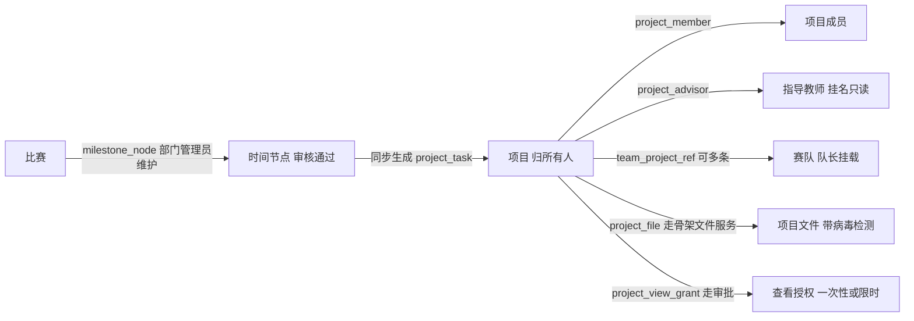
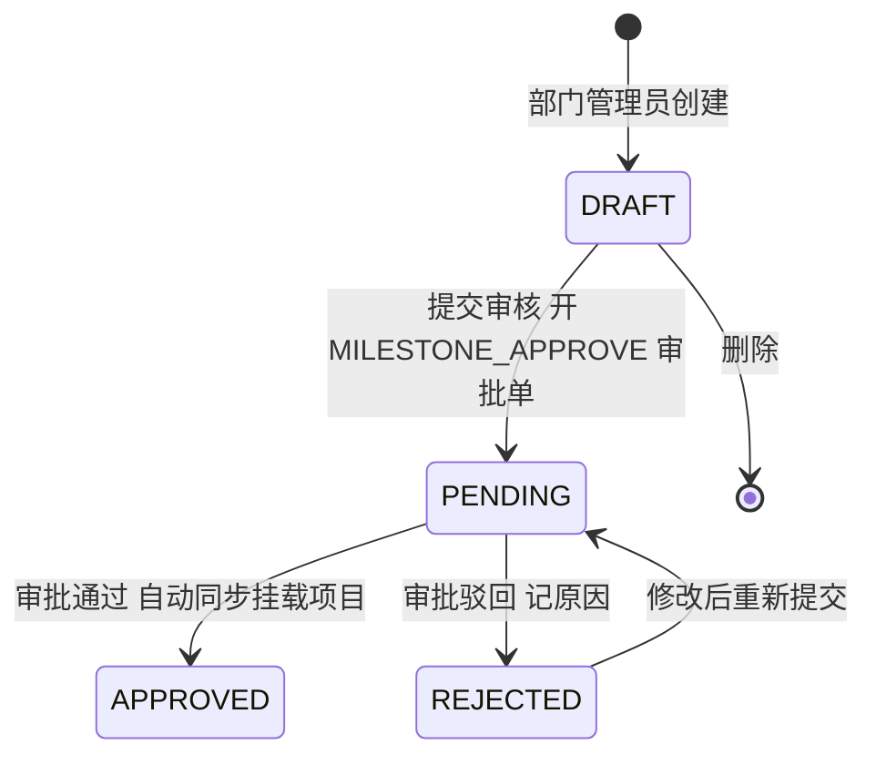

# 项目管理-接口清单

> 作者：ZCode（后端开发）｜创建时间：2026-10-12
> 负责人：项目管理线（后 9 模块之一，具体人选待组长定）｜错误码段：7xxx
> 状态：已入库 docs/api（2026-10-12 组长确认）。待录入 Apifox；录入后以 Apifox 为准
> 依据：PRD §3.10 项目管理；表：project、project_member、project_advisor、team_project_ref、milestone_node、project_task、project_file、project_view_grant（8 张，表结构即契约）
> 前置依赖：骨架认证/数据范围/角色注解（已交付）、骨架文件服务 /api/files（已交付）、审批中心 ApprovalClient 与 PROJECT_VIEW、MILESTONE_APPROVE 回调（已交付，见同日《审批中心-接口清单》）、B 线 team 与 team_member 数据（挂载校验用，只读）
> 通用约定见《全局接口与开发规范》，本文不重复

## 0. 一句话理解项目管理

项目是**个人资产**：谁创建谁拥有，所有人对项目有完整管理权，加成员、加指导教师都不用审批。赛队是**租客**：比赛打起来时队长把项目挂载到赛队，一个项目可同时被多支赛队挂载去打不同比赛。时间节点是**闹钟**：部门管理员维护比赛的关键日期（报名开始、作品提交等），审核通过后自动给挂载了该比赛的项目生成对应任务。

## 1. 错误码表（7xxx）

| code | 含义 |
|------|------|
| 7001 | 项目不存在 |
| 7002 | 仅项目所有人可操作 |
| 7003 | 无权查看该项目 |
| 7004 | 同学期同组织内项目名已存在 |
| 7005 | 该人员已是项目成员 |
| 7006 | 指导教师必须是教师类型人员 |
| 7007 | 该赛队已挂载此项目 |
| 7008 | 挂载的项目与赛队不在同一学期 |
| 7009 | 时间节点当前状态不允许该操作 |
| 7010 | 项目有挂载中的赛队，请先解绑 |
| 7011 | 已存在待审批的查看申请，请勿重复提交 |
| 7012 | 任务不存在或不属于该项目 |

## 2. 可见性判定（本模块最复杂的规则，所有读接口共用）

按顺序判定，命中任一条即可看：

| 序 | 谁 | 规则 |
|----|----|------|
| 1 | 项目所有人 | 永远可见，可改可删 |
| 2 | 项目成员 / 指导教师 | 可见（指导教师只读） |
| 3 | 超级管理员 | 全部可见（PRD 字面写"本部门"，与全系统"超管看全部"惯例矛盾，按惯例设计，见待确认①） |
| 4 | 部门管理员 | 项目所属组织在其管辖子树内即可见 |
| 5 | visibility=PUBLIC | 全平台可见 |
| 6 | visibility=ORG | 与项目同部门（项目 org 子树内）的用户可见 |
| 7 | 有 ACTIVE 查看授权 | project_view_grant 生效中：ONCE 未用完 / LIMITED 未到期 |
| 8 | 都不满足 | 不可见（7003），前端引导提交查看申请 PR28 |

写接口权限一律**仅所有人**（7002）；项目状态流转也归所有人。

## 3. 接口明细

### 3.1 项目主体（/api/projects）

| 编号 | 接口 | 说明 |
|------|------|------|
| PR01 | GET /api/projects | 列表。数据范围按角色自动：超管全部、部门管理员本子树、学生=自己参与的（所有人或成员或指导教师）加授权可见的。筛选：keyword 名称模糊、status、contestId、semesterId、orgId。列表项：id name ownerName orgName semesterName contestName status visibility startDate endDate |
| PR02 | POST /api/projects | 创建。所有人=当前用户。body：name description contestId trackId（可选）semesterId（默认当前学期）orgId（默认本人组织）visibility（默认 ORG）startDate endDate remark。同学期同组织内名称唯一（7004）。带幂等头 |
| PR03 | GET /api/projects/{id} | 详情=基本信息+所有人+visibility。可见性按 §2 判定（7003）。**ONCE 授权在此消耗**：命中第 7 条且 grantType=ONCE 时 used_count 加一、用完置 EXPIRED |
| PR04 | PUT /api/projects/{id} | 编辑基本信息与状态流转。仅所有人（7002）。status 流转限 ACTIVE→FINISHED→ARCHIVED 按序 |
| PR05 | DELETE /api/projects/{id} | 删除（逻辑删）。仅所有人；有 ACTIVE 挂载的赛队拒绝（7010，先解绑）；任务/文件/授权随项目逻辑删 |

### 3.2 成员与指导教师（进程内直调 A 线人员数据校验，不走审批）

| 编号 | 接口 | 说明 |
|------|------|------|
| PR06 | GET /api/projects/{id}/members | 成员列表含角色与加入时间。项目可见者可看 |
| PR07 | POST /api/projects/{id}/members | 添加成员。仅所有人；body：memberId。已在项目 7005。**不走审批**（PRD §3.9 审批清单不含项目加人） |
| PR08 | DELETE /api/projects/{id}/members/{memberId} | 移除成员。仅所有人；OWNER 行不可移除（7002） |
| PR09 | POST /api/projects/{id}/advisors | 添加指导教师。仅所有人；目标须教师类型（7006） |
| PR10 | DELETE /api/projects/{id}/advisors/{memberId} | 移除指导教师。仅所有人 |

### 3.3 赛队挂载（表在项目域，接口由项目线出，B 线前端在赛队详情页调用）

| 编号 | 接口 | 说明 |
|------|------|------|
| PR11 | GET /api/projects/{id}/teams | 使用本项目的赛队列表：teamId teamName contestName trackName attachedByName attachedAt status。项目可见者可看 |
| PR12 | GET /api/teams/{id}/projects | 本队挂载的项目列表。本队成员与管理员可看 |
| PR13 | POST /api/teams/{id}/projects | 队长挂载项目。body：projectId trackId。校验：操作人是该队队长（读 B 线 team_member）、项目可见（§2）、同学期（7008）、同队同项目同赛道不重复（7007）。**挂载时回溯**：该项目关联比赛下若有未同步的已审核节点，补建对应任务 |
| PR14 | DELETE /api/teams/{id}/projects/{projectId} | 解绑（置 RELEASED）。队长；已生成的任务不回收 |
| PR15 | GET /api/projects/attachable | 可挂载项目池（挂载选择器用）：visibility 为 PUBLIC 或 ORG 同部门的、加自己参与的。可选筛选 contestId |

### 3.4 比赛时间节点（/api/contests/{id}/milestones 与 /api/milestones，管理员维护）

| 编号 | 接口 | 说明 |
|------|------|------|
| PR16 | GET /api/contests/{id}/milestones | 节点列表。管理员看全部；普通用户仅 APPROVED。筛选 status nodeType |
| PR17 | POST /api/contests/{id}/milestones | 创建（DRAFT）。仅部门管理员与超管。body：nodeType（REGISTER_START / REGISTER_END / WORK_SUBMIT / OTHER）name nodeTime description |
| PR18 | PUT /api/milestones/{id} | 编辑。仅 DRAFT 与 REJECTED 可编辑（7009） |
| PR19 | DELETE /api/milestones/{id} | 删除。仅 DRAFT（7009） |
| PR20 | POST /api/milestones/{id}/submit | 提交审核：转 PENDING 并调 ApprovalClient 创建 MILESTONE_APPROVE 单（审批人推荐超管，见待确认②）。带幂等头 |

审批回调（项目线实现 ApprovalHandler）：通过→节点转 APPROVED、回填 approved_at 与 approved_by、**同步**=给挂载该比赛的每个 ACTIVE 项目创建一条任务（title=节点名、due_date=节点时间、milestone_node_id 回填）并置 synced=1；驳回→转 REJECTED 记 reject_reason。

### 3.5 项目任务（/api/projects/{id}/tasks）

| 编号 | 接口 | 说明 |
|------|------|------|
| PR21 | GET /api/projects/{id}/tasks | 任务列表。项目可见者可看。筛选 status assigneeMemberId；按 sort_no 排序 |
| PR22 | POST /api/projects/{id}/tasks | 创建手工任务（milestone_node_id 为空）。仅所有人。body：title description assigneeMemberId dueDate priority sortNo |
| PR23 | PUT /api/projects/{id}/tasks/{taskId} | 编辑或更新状态。所有人可改全部字段；任务负责人本人仅可将状态置 DONE（completed_at 与 completed_by 回填） |
| PR24 | DELETE /api/projects/{id}/tasks/{taskId} | 删除。仅所有人；同步生成的任务也可删（删后不自动重建） |

### 3.6 项目文件（上传走骨架 /api/files 拿 fileId，下载走本线接口，对齐 C 线 MS04 口径）

| 编号 | 接口 | 说明 |
|------|------|------|
| PR25 | GET /api/projects/{id}/files | 文件列表：fileName fileSize fileCategory scanStatus uploadedByName createdAt。项目可见者可看 |
| PR26 | POST /api/projects/{id}/files | 上传。所有人**与项目成员**可传；multipart：file fileCategory（DOC / IMAGE / CODE / OTHER）remark。先走骨架 F01（格式与大小校验、ClamAV 强制检测，INFECTED 拒绝并审计），拿 fileId 后建 project_file 关联。带幂等头 |
| PR27 | DELETE /api/projects/{id}/files/{fileRecordId} | 删除（逻辑删关联，文件对象保留）。所有人；成员仅可删自己上传的 |
| PR28 | GET /api/projects/files/{fileRecordId}/download | 下载。**必须先过 §2 项目可见性校验**再流式转发，不暴露对象存储地址；每次下载写审计（操作人、时间、IP） |

### 3.7 查看申请与授权（走审批中心 PROJECT_VIEW）

| 编号 | 接口 | 说明 |
|------|------|------|
| PR29 | POST /api/projects/{id}/view-requests | 提交查看申请。body：grantType（ONCE / LIMITED）expireAt（LIMITED 必填）。落 project_view_grant（PENDING）并调 ApprovalClient 创建 PROJECT_VIEW 单，审批责任组织=项目所属组织。已有 PENDING 拒绝（7011）。带幂等头 |
| PR30 | GET /api/projects/{id}/view-grants | 授权列表（谁申请过、类型、状态、到期时间）。仅所有人与管理员 |
| PR31 | PUT /api/view-grants/{id}/revoke | 撤销授权（置 REVOKED）。仅所有人与管理员 |

审批回调（项目线实现）：通过→grant 转 ACTIVE（LIMITED 的 expire_at 生效）；驳回→置失效。PRD"图片入 MinIO 其他入 MySQL"按骨架统一口径执行：**文件本体全走骨架文件服务入 MinIO，project_file 只存关联与冗余**（file_category 已区分图片/文档/代码）。

## 4. 与骨架和其他线的对接点

- 骨架文件服务：PR26 上传先走 F01；PR28 下载对齐 C 线 MS04 模式（业务线先校验可见性再流式转发），不给前端暴露 F02 直链
- 审批中心：PR20 产生 MILESTONE_APPROVE、PR29 产生 PROJECT_VIEW（对接细节见《审批中心-接口清单》§5）；项目线实现两个 ApprovalHandler
- B 线：PR13 挂载校验读 team 与 team_member（队长身份、同学期）；PR11/PR12 两个列表互为镜像（赛队详情页与项目详情页各展示一侧）
- A 线：PR07/PR09 校验人员存在与类型时读 member；PR01 默认学期取当前激活学期
- 概览统计：项目数=PR01 的 total（拍板口径：不新增统计接口）

## 5. 待确认事项

- [ ] (需用户确认) PRD §3.10"超级管理员：可看本部门所有项目"与全系统"超管看全部"矛盾——本清单按**超管看全部**设计（推荐，与其他模块一致）
- [ ] (需用户确认) MILESTONE_APPROVE 审批人：部门管理员"自己维护自己审核"无意义，本清单推荐**发起=维护节点的部门管理员、审批=超管**；备选：同部门另一名管理员（当前每部门仅 1 名管理员，不成立）
- [ ] (需用户确认) 管理员是否可编辑或删除他人的项目：PRD 未授权，本清单按**仅所有人**（7002）从严设计
- [ ] (需用户确认) ONCE 授权"看一次详情即消耗"体验较差（刷新页面会重复计数），是否前端默认引导 LIMITED；或改为"当天内不限次"
- [x] (2026-10-12 组长确认) 已移入 docs/api
- [ ] (需用户确认) 录入 Apifox 项目管理目录
