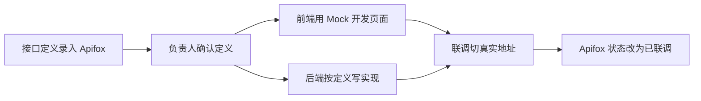

# VIOManager 全局接口与开发规范

> 作者：ZCode（方案架构师）｜创建时间：2026-10-07 21:35
> 状态：**待组长确认后生效**——确认后全组遵守，修改需组长批准
> 定位：全项目的"宪法"。`docs/db/initsql.sql`（52 张表）+ 本规范 = 全组唯一契约。

## 0. 三条铁律

1. **表结构即契约**：所有模块对着 52 张表开发；改表必须先提方案、组长批准，改完同步更新 SQL 文件
2. **接口先行**：每个接口先在 Apifox 登记定义（路径、参数、响应示例、错误码），对应负责人确认后，前后端才并行开工
3. **改规范走流程**：本文件与表结构的任何修改，需先在群里说明原因，组长批准后生效

## 1. 接口文档管理（Apifox + Markdown 双轨）

| 载体 | 放什么 | 谁维护 |
|------|--------|--------|
| Apifox | 接口明细：路径、参数、响应示例、Mock 数据、各域错误码表 | 各域负责人维护自己的目录 |
| 本文件 + docs/ | 规律：规范、错误码分段、字段可见性规则、分工 | 组长 |

- Apifox 目录按域划分，目录名 = 负责人，权限只开自己域
- 接口状态流转：`设计中 → 已确认 → 开发中 → 已联调`
- 前端基于 Apifox Mock 开发页面，**不等后端写完**
- **变更接口必须先改 Apifox 再改代码**，并在群里 @ 受影响的人
- 后端代码不再写接口注释文档，Apifox 是唯一真相源

接口先行的协作流程：



## 2. 统一请求与响应

### 2.1 基础约定

- Base URL：`/api`；Content-Type：`application/json`（文件上传用 multipart）
- JSON 字段一律 camelCase；数据库 snake_case 由后端自动转换
- 时间 `yyyy-MM-dd HH:mm:ss`，日期 `yyyy-MM-dd`（PRD §4 统一格式）
- **ID 一律按字符串传输**：雪花 ID 是 19 位长整数，超过 JS 安全整数上限，前端会精度丢失。后端全局配置 Long → String 序列化，所有 id 字段 JSON 里是字符串
- 枚举传英文大写值（如 `STUDENT` / `TEACHER`），中文文案由后端字典接口提供，前端不硬编码枚举翻译

### 2.2 统一响应体

```json
// 成功
{ "code": 0, "message": "ok", "data": { "id": "1930123456789012480", "name": "张三" } }
// 失败
{ "code": 4003, "message": "队名已存在", "data": null }
```

### 2.3 分页

- 请求：`GET /api/xxx?page=1&size=20&keyword=张`
- 响应：`data: { "list": [...], "total": 128, "page": 1, "size": 20 }`
- 默认 size=20，上限 100；keyword 模糊搜索防抖 300ms（PRD §4）

## 3. 路径与命名

### 3.1 域前缀 = 责任田

| 前缀 | 域 | 负责人 |
|------|----|--------|
| /api/auth、/api/files | 认证账号、文件公共服务 | 组长（骨架） |
| /api/approvals | 审批中心 | 组长 |
| /api/members、/api/orgs、/api/semesters | 人员、组织、学期 | A 线 |
| /api/contest-templates、/api/contests、/api/teams | 比赛模板、比赛、赛队 | B 线 |
| /api/materials、/api/achievements | 材料、成果 | C 线 |
| /api/projects、/api/schedules、/api/performance、/api/tech-posts、/api/kb、/api/ai、/api/audit-logs、/api/stats | 项目、排班、绩效、技术交流、知识库、AI、审计、概览 | 后 9 模块 3 人 |

### 3.2 动词约定

- GET 查询 / POST 创建 / PUT 修改 / DELETE 删除（一律逻辑删除）
- 无法映射成资源的动作用 POST + 动词端点：如 `POST /api/teams/{teamId}/members/{memberId}/confirm`

### 3.3 三个例子看懂命名

```
GET    /api/contests/{id}                              查比赛详情
POST   /api/teams                                      创建赛队（发起组队申请）
POST   /api/approvals/{id}/approve                     审批通过
GET    /api/members?orgId=xx&keyword=李&page=1         按组织+关键词查人员
```

## 4. 错误码分段（防多人冲突的核心机制）

每条线只用自己的段位，新增错误码登记到 Apifox 自己目录的错误码表：

| 段 | 域 | 维护人 |
|----|----|--------|
| 0 | 成功 | — |
| 1xxx | 通用（下表，任何人不得占用） | 组长 |
| 2xxx | 认证与账号 | 组长 |
| 3xxx | 人员、组织、学期 | A 线 |
| 4xxx | 比赛、赛队 | B 线 |
| 5xxx | 材料、成果 | C 线 |
| 6xxx | 审批中心 | 组长 |
| 7xxx | 项目管理 | 后 9 模块分摊 |
| 8xxx | 排班、绩效 | 后 9 模块分摊 |
| 9xxx | 技术交流、知识库、AI、审计 | 后 9 模块分摊 |

通用码表（1xxx）：

| code | 含义 |
|------|------|
| 1001 | 参数校验失败（message 说明哪个字段） |
| 1002 | 未登录或令牌过期（前端跳登录页） |
| 1003 | 无权限 |
| 1004 | 资源不存在 |
| 1005 | 重复提交（幂等拦截） |
| 1006 | 当前状态不允许该操作 |
| 1007 | 数据已被他人修改，请刷新后重试 |

## 5. 认证、权限与数据范围

### 5.1 认证

- 登录后所有请求带 Header：`Authorization: Bearer <JWT>`
- 1002/HTTP 401：未登录或过期 → 前端统一拦截跳登录页
- 1003/HTTP 403：无权限。PRD 里"无权限可转申请"的场景（如项目查看）返回业务提示引导发申请，不裸拒

### 5.2 数据范围（后端强制）

- 后端统一拦截：按当前用户角色自动注入组织子树过滤（超管全平台 / 部门管理员本部门含下级 / 学生仅自己参与的数据）
- 前端传的 orgId 只能**收窄**筛选范围，不能扩大——越权由后端封堵
- AI 助手调用后端工具时转发用户令牌，权限与本人完全一致（PRD §3.15）

### 5.3 字段可见性（PRD §2.3 表的落地）

- **后端在返回前按角色裁剪字段**，前端不做任何安全决策
- 身份证号：列表只返回后 4 位（`idCardLast4`）；完整值仅在详情接口且仅超管/本部门管理员/本队队长/本人可见
- 登录名：仅本人和超管可见
- 身份证/证件照下载走独立鉴权端点，写审计日志（操作人、时间、IP）

### 5.4 一次请求经过的关口（骨架实现，全组受益）


## 6. 写操作防护

- 创建、审批、提交类接口必须带 Header `X-Idempotency-Key`（前端生成：用户ID+业务标识+随机数），后端 `idempotent_record` 落库，重复键直接返回首次结果
- 前端：提交中禁用按钮、断网不重放、列表快速切换丢弃过期响应（PRD §4）
- 删除、解散等高危操作：后端二次校验 + 前端二次确认弹窗

## 7. Git 协作（直推 main 模式）

团队决策：所有提交直推 main。配套护栏：

- **推前必须 `git pull --rebase`**，禁止 force push
- commit 格式：`feat(模块): 描述` / `fix(模块): 描述` / `docs(文档): 描述`
- **公共文件改动先报备**：骨架代码、本规范、52 表 SQL、公共组件——改之前群里说一声，改完通知
- 小步提交：一个功能点一个 commit，禁止攒一个大提交
- 谁推坏的谁回修；主干挂了组长回滚

## 8. 代码组织速查

### 8.1 后端（Spring Boot 3 / Java 21）

- 包结构：`com.viomanager.{模块}` 内分 controller / service / mapper / entity / dto
- 骨架提供：统一响应体、全局异常、JWT 过滤器、数据范围注解、雪花 ID、逻辑删除基座、审计 AOP、幂等拦截、MinIO 文件服务
- 单文件不超过 300 行，超过就拆分封装
- 枚举统一放 `common.enums`，字典接口统一从 `sys_dict` 读

### 8.2 前端（Vue3 + TS + Element Plus + Pinia）

- 目录：`src/api/{模块}.ts`、`src/views/{模块}/`、路由按模块拆分懒加载
- 所有请求走封装后的 axios 实例，页面里禁止裸调
- 骨架提供：布局、路由守卫、上传组件、字段裁剪展示组件、字典 hook

## 9. 待确认事项

- [ ] (需用户确认) 3 人队报名填前 1 还是前 2——影响 B 线组队接口的校验规则
- [ ] (需用户确认) 分页 size 上限 100 是否合适
- [ ] (需用户确认) 幂等键过期时长（建议 24 小时）
- [ ] (需用户确认) Apifox 项目由组长创建并拉 7 人进组，目录按 §3.1 责任田划分
- [ ] (需用户确认) 后 9 模块 3 人的 7xxx/8xxx/9xxx 段位具体怎么分

## 变更记录

| 版本 | 日期 | 说明 |
|------|------|------|
| v0.1 | 2026-10-07 | 初稿，待组长确认 |
