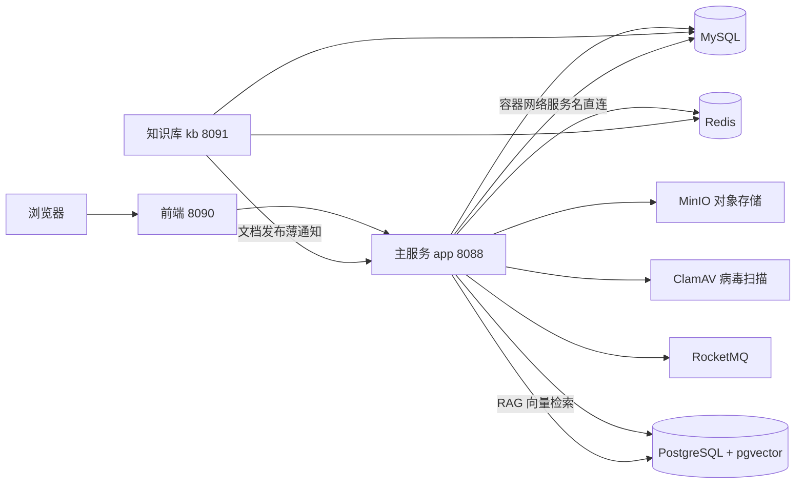

# VIOManager 部署与使用指南

> 面向部署者与试用者：三条命令把平台跑起来，演示账号直接登录体验。
> 开发者另见文末「跑测试」与「常见问题」。

## 一、环境要求

| 依赖 | 说明 |
|------|------|
| Docker + Docker Compose | 唯一硬依赖——所有服务容器化，宿主不需要 JDK/MySQL/Node |
| 网络 | 首次构建需拉取 Maven 依赖与基础镜像 |
| （可选）宿主 Ollama | AI 助手走本地大模型时需要；不配 AI 相关变量则 AI 功能零装配照常跑 |

## 二、快速启动

```bash
# 1. 基础设施（MySQL/Redis/MinIO/ClamAV/PostgreSQL）
docker compose up -d

# 2. 全量部署（含 RocketMQ + 主服务 app + 知识库服务 kb，首次会构建镜像，约 3-5 分钟）
docker compose -f docker-compose.apps.yml --profile app up -d --build

# 3. 验证：主服务与知识库服务都返回未登录错误（说明服务活着）
curl http://localhost:8088/api/ai/status
```

首次启动说明：

- 数据库表结构与演示数据由 Flyway 迁移自动创建，无需手工导 SQL；MySQL 健康后服务自动启动。
- **镜像构建带 `-DskipTests`**：构建不跑测试、不需要测试环境；测试只在开发机上跑（见第七节）。
- 前端为独立仓库，容器名 `vio-front-web`（端口 8090）；本仓库只含后端。

## 三、服务拓扑



所有容器间依赖一律走 compose 服务名（`mysql`/`redis`/`minio`…），不依赖宿主端口。

## 四、端口清单

| 端口 | 服务 | 用途 |
|------|------|------|
| 8088 | app 主服务 | 全部业务 API（认证/人员/组织/学期/比赛/赛队/材料/成果/项目/排班/绩效/审批/AI） |
| 8091 | kb 知识库服务 | 知识库文档/收藏/评论 API |
| 8090 | 前端 | 页面入口（独立部署） |
| 3307 | MySQL | 宿主侧连接（容器间走 3306 服务名，不用此口） |
| 5433 | PostgreSQL | RAG 向量库宿主侧连接 |
| 6379 | Redis | 缓存（组织树/未读红点等，连不上自动降级直查库） |
| 9000/9001 | MinIO | 对象存储 API / 控制台 |

## 五、配置（.env）

compose 支持环境变量覆盖，默认值面向本地演示。**生产部署必改清单**（与《上线检查清单》红线一致）：

| 变量 | 默认值（演示） | 说明 |
|------|----------------|------|
| `JWT_SECRET` | 内置开发串 | 认证签名密钥，**必须**换 32 字节以上随机串 |
| `MYSQL_ROOT_PASSWORD` | dev-root-123 | MySQL 口令，与 compose 的 mysql 服务同步生效 |
| `MINIO_ROOT_USER` / `MINIO_ROOT_PASSWORD` | vio-minio / dev-minio-123 | 对象存储凭据 |
| `RAG_INTERNAL_TOKEN` | dev-rag-internal | kb→app 索引同步内部令牌 |
| `GLM_BASE_URL` / `GLM_MODEL` / `GLM_API_KEY` | 空 | AI 助手云端三件套；不配 = 零装配。**key 只进环境变量，绝不写文件** |
| `OLLAMA_BASE_URL` | http://host.docker.internal:11434 | 本地大模型地址（容器经 host-gateway 访问宿主 Ollama） |
| `VIO_RAG_ENABLED` | true | RAG 开关；false 时无任何 PG Bean 照常启动 |
| `VIO_CORS_ALLOWED_ORIGINS` | 8090,5174 | 前端源白名单，换域名要带上 |

## 六、演示账号

种子数据自带完整故事线的演示账号（演示环境专用，生产环境全部禁用）：

| 账号 | 密码 | 角色 | 演示看点 |
|------|------|------|----------|
| admin | Admin@123456 | 超级管理员 | 全平台管理、学期切换任务流、系统配置 |
| dept_chen | Dept@123456 | 部门管理员 | 程序设计协会：审批待办、组织管理 |
| dept_liu | Dept@123456 | 部门管理员 | 电子设计协会：跨部门数据隔离对比 |
| dept_wu | Dept@123456 | 部门管理员 | 机械创新协会：干净沙盒部门，全流程可演练 |
| stu_wang | Stu@123456 | 学生 | 队长视角：建队/材料/成果/AI 助手 |
| stu_zhao | Stu@123456 | 学生 | 普通队员视角 |
| stu_sun | Stu@123456 | 学生 | 芯火电子队队长：被邀请/待办审批 |
| stu_li | Stu@123456 | 学生 | 无队伍无审批的干净学生：从建队到挂项目全流程 |

## 七、AI 助手与知识库（部署后一步）

1. **模型二选一**：云端配 `GLM_*` 三件套；或宿主装 Ollama 并拉 `qwen2.5:7b` 与 `nomic-embed-text` 两个模型（对话 + 向量化各司其职）。
2. **RAG 冷启动**：知识库语料（15 篇平台使用指南）已随 Flyway 种子入库，但**种子不触发索引构建**——新环境启动后用超管账号调一次重建：

```bash
curl -X POST http://localhost:8088/api/kb/admin/rag-rebuild \
  -H "Authorization: Bearer <admin的token>"
```

3. 之后在聊天页问「怎么创建队伍」「周报一周能交几份」，AI 会引用具体指南篇目回答并带出处。

## 八、跑测试（开发者）

前置：第四节容器全家桶运行中 + 宿主 Ollama 在跑。测试直连本地容器（3307/5433 等），与部署互不影响。

```bash
cd backend
mvn test                                    # 主服务 vio-management
MYSQL_PORT=3307 MYSQL_PASSWORD=dev-root-123 \
  mvn -pl vio-kb test                       # 知识库 vio-kb（需显式指定库端口口径）
```

## 九、常见问题

- **服务起不来报 `UnknownHostException: mysql`**：容器断电/掉线后网络端点丢失，`docker inspect <容器> --format '{{.NetworkSettings.Networks}}'` 查看是否为空；为空则重建该容器（数据在卷里不会丢）。
- **Docker Desktop 反复掉线**：内存不足的典型症状，先关掉不需要的容器栈再跑全量测试。
- **文件上传报「对象存储不可用」**：检查 MinIO 容器是否在跑（宿主 9000 口）。
- **AI 回答「知识库暂不可用」**：`VIO_RAG_ENABLED` 未开或 PostgreSQL 容器未启动。
